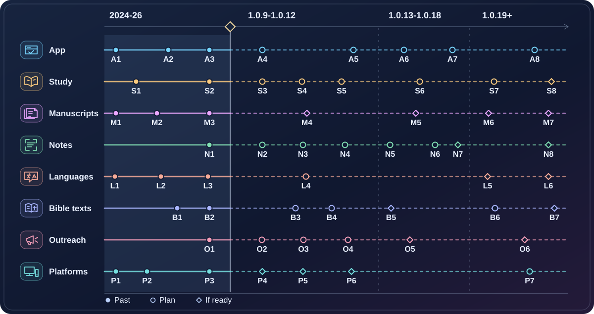

# Revelation project roadmap

[Русская версия](ROADMAP.md)

**Status as of 14 November 2026 · Current release [1.0.8+178](https://github.com/karnauhov/Revelation/releases/tag/v1.0.8%2B178) · Next release 1.0.9.**

Revelation grew from a manuscript catalogue into an app for reading and studying the Bible. The next goal is to publish complete studies of the Book of Revelation that connect each conclusion to the biblical text, manuscript evidence and context. Features, study materials and translations can progress at different speeds.

The codes below identify the eight tracks: A for App, S for Study, M for Manuscripts, N for Notes, L for Languages, B for Bible texts, O for Outreach and P for Platforms. The chart moves from past releases to 1.0.9-1.0.12, then 1.0.13-1.0.18 and later versions. The spacing between points does not represent time or completion.

<!-- roadmap milestones: start -->

## Milestone details

### A · App

-  **A1** · 1.0.1: Added a manuscript page viewer with controls and zoom on web and Windows.
-  **A2** · 1.0.5: Added interactive verse areas and links from verses to words on facsimiles.
-  **A3** · 1.0.7: Added Bible search, parallel reading and a standalone Strong's Dictionary.
-  **A4** · 1.0.9: Search for Old Testament allusions and resume reading from the saved position (REV113, REV212).
-  **A5** · 1.0.12: Download a data pack and read offline (REV197, REV149-REV151).
-  **A6** · 1.0.14: Show parts of speech and sentence roles in manuscript overlays (REV156, REV157).
-  **A7** · 1.0.18: Show illustrations for individual paragraphs and support keyboard or remote navigation (REV163, REV161).
-  **A8** · 1.0.19: Add the original Greek and Hebrew entries from Strong (REV135, REV232).

### S · Study

-  **S1** · 1.0.0: Released a preface explaining primary sources, study principles and stages.
-  **S2** · By 1.0.8: An introduction to Revelation 1:1-3 is available. The full seven-stage study is planned.
-  **S3** · 1.0.9: Prepare a sample study of Revelation 1:1-3 and test the format with allusion search (REV213).
-  **S4** · 1.0.10: Publish the first complete study of 1:1-3 after all seven stages and review (REV242).
-  **S5** · 1.0.11: Complete the full prologue, 1:1-8, with supporting material (REV246).
-  **S6** · 2027-2029: Publish reviewed studies of the messages to the seven churches individually or in small groups (REV3).
-  **S7** · 2029-2032: After the messages, publish studies of the seals and trumpets in short packages (REV3).
-  **S8** · From 2032: After the trumpets, move on to the final crisis and the bowls, then the kingdom, New Jerusalem and epilogue (REV3).

### M · Manuscripts

-  **M1** · 1.0.1: Added the first nine image sets, including U001 and P018.
-  **M2** · 1.0.2: Added 93 images of U051.
-  **M3** · 1.0.7: Added images of U207, U229 and P098.
-  **M4** · 1.0.10-1.0.12: Register up to two new sources as images and rights become available (REV145, REV153).
-  **M5** · 1.0.14-1.0.16: Check one further slot and two INTF candidates, 20325 and 20326 (REV168, REV169).
-  **M6** · 1.0.23: Add U025 facsimiles after digitization, page verification and permission (REV5, REV140, REV159).
-  **M7** · 1.1.x: Acquire and catalogue U052 images. Confirm the page count during inventory (REV5, REV228).

### N · Notes

-  **N1** · By 1.0.8: Three U001/U002/U004 pages contain 156 annotated words, 154 Strong's links and 8 verse areas.
-  **N2** · 1.0.9: Complete P018/P098 verification and add to three partly annotated pages in pilot W00 (REV218).
-  **N3** · 1.0.10: Annotate all 18 images of eight small fragments (REV219).
-  **N4** · 1.0.11-1.0.12: Complete P115/U001 and P047/U002, including the partly annotated pages (REV220, REV221).
-  **N5** · 1.0.13: Finish annotating all 16 U004 images (REV222).
-  **N6** · 1.0.14-1.0.16: Annotate all 93 U051 images in three groups of 31 (REV223-REV225).
-  **N7** · 2030, subject to access and rights: Annotate 39 U046 images in the 1.0.17-1.0.18 windows and release them as they are verified (REV226).
-  **N8** · Annotate U025 and U052 after their pages are catalogued. Use the inventory to estimate scope and timing (REV227, REV228).

### L · Languages

-  **L1** · 1.0.0: Released the interface in English, Ukrainian and Russian.
-  **L2** · 1.0.3: Added a Spanish interface.
-  **L3** · 1.0.4: Added Greek Strong's Dictionary entries in four languages.
-  **L4** · 1.0.10-1.0.11: Review English, Spanish, Ukrainian and Russian alongside the first completed studies.
-  **L5** · 1.1.x: Choose the next language based on demand, interface readiness and the availability of a Bible translation with permission (REV208).
-  **L6** · Expand to more regions after the pilot. Check content and the capacity to maintain each language.

### B · Bible texts

-  **B1** · 1.0.7: Released English KJV and Greek LXX/TR.
-  **B2** · 1.0.8: Released Ukrainian OH1988 with footnotes. Strong's annotation follows separate research.
-  **B3** · 1.0.10: Release the Russian text module after verifying the edition (REV202).
-  **B4** · 1.0.11: Release the Spanish text module after verifying the edition (REV203).
-  **B5** · After Russian and Spanish: Choose one further translation and prepare a limited text pilot (REV217).
-  **B6** · 1.0.20-1.0.22: Compare TR, KJV and LXX against printed editions and add footnotes (REV180, REV194, REV196).
-  **B7** · 1.1.x: Release reviewed Strong's annotation for OH1988 and the future Russian and Spanish Bibles as each research project is completed (REV229-REV231).

### O · Outreach

-  **O1** · 1.0.8: Published a one-minute Ukrainian reading example on the website and launched the campaign (REV235).
-  **O2** · 1.0.9: Review the Ukrainian campaign after the full 14-day window (REV235).
-  **O3** · 1.0.10: Make it easier for readers to send feedback (REV216).
-  **O4** · 1.0.12: Compare social networks and choose up to two channels for a pilot (REV177).
-  **O5** · After the full prologue: Test it with a small group. Contact OneVoice27 after a successful pilot (REV214, REV304).
-  **O6** · Longer term: Run language and regional campaigns based on reader interest and results from earlier campaigns.

### P · Platforms

-  **P1** · 1.0.0: First release on Android.
-  **P2** · 1.0.1-1.0.3: Launched web, Windows and Linux/Snap.
-  **P3** · 1.0.8: Verified delivery via the site and stores using local builds and acceptance testing.
-  **P4** · 1.0.9: Prepare Windows signing and use it in local builds (REV165, REV167).
-  **P5** · From 1.0.10: Prepare iOS and macOS for Apple review. Galaxy Store depends on store readiness (REV123, REV154, REV160).
-  **P6** · 1.0.11-1.0.12: Check AppGallery, F-Droid and Flathub requirements and publish when ready (REV146, REV141, REV147).
-  **P7** · 1.1.x: Maintain reproducible builds, local acceptance testing and performance checks (REV144, REV133).

<!-- roadmap milestones: end -->

## Release history

| Version and date | What changed |
| --- | --- |
| [Project begins](https://github.com/karnauhov/Revelation/commit/4a4706b) · 21 Dec 2024 | First commit, Flutter foundations and the primary source catalogue. |
| [1.0.0+27](https://github.com/karnauhov/Revelation/tree/v1.0.0%2B27) · 29 Mar 2025 | First Android release, a preface, a catalogue of 7 papyri and 12 uncials, and an interface in English, Ukrainian and Russian. |
| [1.0.1+69](https://github.com/karnauhov/Revelation/compare/v1.0.0%2B27...v1.0.1%2B69) · 2 May 2025 | Web and Windows support, a manuscript page viewer, nine sets of facsimiles and images sized for mobile browsers. |
| [1.0.2+80](https://github.com/karnauhov/Revelation/compare/v1.0.1%2B69...v1.0.2%2B80) · 31 May 2025 | U051 images, image adjustment controls and saved page settings. |
| [1.0.3+113](https://github.com/karnauhov/Revelation/compare/v1.0.2%2B80...v1.0.3%2B113) · 4 Jul 2025 | Linux via Snap, Spanish localization, P085 and a redesigned interface and settings. |
| [1.0.4+134](https://github.com/karnauhov/Revelation/compare/v1.0.3%2B113...v1.0.4%2B134) · 22 Feb 2026 | SQLite, Greek Strong's Dictionary in four languages, word and Strong's number overlays, and U002 and P043 images. |
| [1.0.5+146](https://github.com/karnauhov/Revelation/compare/v1.0.4%2B134...v1.0.5%2B146) · 28 Mar 2026 | Interactive verse areas and links to individual words on facsimiles, a content editor, independent data updates and an app architecture refactor. |
| [1.0.6+156](https://github.com/karnauhov/Revelation/compare/v1.0.5%2B146...v1.0.6%2B156) · 2 May 2026 | Image caching, comparison of words across manuscripts, richer Markdown and export. |
| [1.0.7+172](https://github.com/karnauhov/Revelation/compare/v1.0.6%2B156...v1.0.7%2B172) · 18 Jul 2026 | KJV and LXX/TR, search and parallel Bible reading, a standalone dictionary, U207/U229/P098 images and error diagnostics. |
| [1.0.8+178](https://github.com/karnauhov/Revelation/compare/v1.0.7%2B172...v1.0.8%2B178) · 14 Nov 2026 | The 1988 Ukrainian Ohienko Bible with verse footnotes, more reliable startup and module updates, local builds and acceptance testing, and the start of Ukrainian reading outreach. |

Release dates come from the [changelog](CHANGELOG.md). Git records the source commits and tagged builds. The first 1.0.0 release predates the +27 tag. The 1.0.8 build commit is dated 8 November, with public release on 14 November. The history snapshot includes 859 commits reachable from [3f17dfd](https://github.com/karnauhov/Revelation/commit/3f17dfd72c5d264b483e98bd19ef98259100b655). The comparison links show the changes between tagged builds. [Changes after the +178 build](https://github.com/karnauhov/Revelation/compare/v1.0.8%2B178...3f17dfd72c5d264b483e98bd19ef98259100b655) record the release and outreach launch.

## Upcoming releases

The windows below are estimates and include a **10% reserve**. The initial estimate allocates 12 weeks to 1.0.9, 16 weeks each to 1.0.10-1.0.12, 17 weeks to 1.0.13 and roughly 22 weeks to each later major step. With the reserve, those estimates are about 13, 18, 19 and 24 weeks. The windows are rounded to a season or half year from the baseline of 14 November 2026. The previous two releases took roughly two and a half and four months. The pace of manuscript annotation and full passage studies still needs to be measured. Image permissions, platform access and store review can affect dates independently. Changes to version scope and task placement require separate agreement.

| Version · Estimated window | App and Bible modules | Studies and manuscripts | Outreach and platforms |
| --- | --- | --- | --- |
| **1.0.9** · Winter 2026/27 | Allusion search, reading and position recovery, fixes to audio and image viewing | Sample study of 1:1-3 and annotation pilot W00 | Review Ukrainian outreach, demonstrate search and reading, prepare Windows signing |
| **1.0.10** · Spring to summer 2027 | Russian Bible, pronunciation and word display in the introduction | Complete 1:1-3, W01, one further source if ready | Reader feedback, preparation for Apple and Galaxy Store |
| **1.0.11** · Autumn 2027 | Spanish Bible, evaluate how to show emphasis in Bible text | Complete prologue 1:1-8 and W02 | Demonstrate Spanish reading, evaluate Huawei AppGallery |
| **1.0.12** · Winter 2027/28 | Downloadable offline study pack, offline testing and selection of the next text module | Next complete passage, pilot the full prologue, W03, one further source | Pilot up to two channels, approach OneVoice27 after a successful prologue pilot, evaluate F-Droid and Flathub |
| **1.0.13** · First half of 2028 | Hebrew Strong's Dictionary | Next study and W04 | Demonstrate the dictionary |
| **1.0.14** · Second half of 2028 | Manuscript overlays for parts of speech and sentence roles | Next study, U051 pages 1-31 and one further source | Demonstrate grammar overlays |
| **1.0.15** · First half of 2029 | Connections between passages and reviewed allusions | Next study, U051 pages 32-62 | Demonstrate links to other Bible books |
| **1.0.16** · Second half of 2029 | Book structure, historical background, practical application and a first map of places in Revelation | Next study, U051 pages 63-93 and evaluation of two candidates | Demonstrate one study workflow |
| **1.0.17** · First half of 2030 | Read-aloud and optional background music | Next study, begin U046 if rights are secured | Demonstrate accessible reading |
| **1.0.18** · Second half of 2030 | Illustrations, related materials, keyboard and remote navigation | Next study, continue U046 | Demonstrate visual study |
| **1.0.19** · First half of 2031 | Original Greek and Hebrew Strong's entries | Next study | Demonstrate the dictionary |
| **1.0.20** · Second half of 2031 | Compare TR against printed editions and add notes | Next study | Demonstrate use of the reviewed text |
| **1.0.21** · First half of 2032 | Compare KJV with print, add notes and show the printed edition if rights allow | Next study | Show the sources of the translation |
| **1.0.22** · Second half of 2032 | Compare LXX with print, add notes and show the printed edition if rights allow | Next study | Demonstrate Greek text study |
| **1.0.23** · 2033 | U025 facsimiles if images and rights are available | Next study and comparison with the U025 transcription | Show the verified facsimile |
| **1.1.x** · From 2033 as ready | Compare editions, recognize and process manuscript images, and evaluate maps of the New and Old Testaments, a timeline, a journal and community features | Remaining passages and manuscripts, with separate Strong's annotation projects | More languages and regions, sustainable support |

Each app release goes through acceptance testing. Store availability, facsimile rights and new research each have their own requirements. Completed data can ship between app releases. A passage study can be complete before every planned app feature becomes available.

## Complete passage studies

The preface and an introduction to 1:1-3 are already available. The 1.0.9 sample demonstrates the format and allusion search. The first full package will cover 1:1-3 in the 1.0.10 window, followed by the full prologue in 1:1-8. The rest of the book will follow in short, complete passages. Every package includes these seven stages.

1. A combined text from the available witnesses, with variant readings and links to manuscript pages.
2. Word studies, verified Strong's links, grammar and syntax.
3. Old Testament allusions, with reasons and links to primary sources.
4. Connections with the person, life and ministry of Jesus Christ.
5. The passage's place in Revelation and relevant connections to Daniel and other biblical texts.
6. Historical context and an assessment of possible prophetic fulfilment grounded in the evidence.
7. Questions and practical application for the reader.

Each package provides a short reading and a detailed study, with sources, Bible references, facsimiles, glossary entries, diagrams and images as needed. We check access and permissions for supporting materials. Before publication we review the four languages, links and evidence, and identify established findings, interpretations and open questions. Agents can draft material, compare evidence and check links. Readers and specialists help where their feedback or review matters.

| Part of Revelation | Work and publication window |
| --- | --- |
| Prologue · 1:1-8 | 2027. Publish the first full package on 1:1-3, complete the prologue and then test it with a group. |
| Seven churches · 1:9-3:22 | 2027-2029. Publish the introduction and the messages in individual packages. |
| Seals · 4:1-8:1 and trumpets · 8:2-11:18 | 2029-2032. Publish the seals and then the trumpets in several packages. |
| Final crisis · 11:19-15:4 and bowls · 15:5-18:24 | From 2032, after the previous studies. |
| Kingdom · 19:1-20:15, New Jerusalem · 21:1-22:5 and epilogue · 22:6-21 | Longer-term 1.1.x work, in order after the bowls. |

The longer-term estimate assumes several short, reviewed packages per year. We will revise that estimate after the prologue and the first messages to the churches. Longer chapters will be split where the text calls for it. The overall completion date remains open (REV2, REV3, REV207, REV213, REV242, REV246).

## Adding primary sources

The catalogue lists 19 manuscripts, with image viewing enabled for 16. The first priorities for access and rights are U046, U025 and U052. U046 needs usable files with permission and attribution. U025 and U052 need facsimiles and an inventory of the pages covering Revelation. Cost and timing depend on the institutions holding them. The slots for 1.0.10, 1.0.12 and 1.0.14 are still open to specific manuscripts. Two further candidates for 1.0.16 are [INTF 20325](https://ntvmr.uni-muenster.de/manuscript-workspace?docID=20325) and [INTF 20326](https://ntvmr.uni-muenster.de/manuscript-workspace?docID=20326). Their page coverage and conditions of use have yet to be established (REV5, REV145, REV153, REV168, REV169).

## Images and manuscript annotation

The published [SQLite catalogue](web/db/revelation.sqlite) (schema 4, data version 11) has **232 unique image records**. Viewing is enabled for 193, and 39 belong to the restricted U046 set. The counts refer to original page records. Preview images and copies sized for mobile browsers are excluded. The viewing flag comes from the catalogue, and file access is checked when a package is reviewed. Three images are partly annotated, with 156 words, 154 Strong's links and 8 interactive verse areas. A page counts as complete after its contents are verified.

| Source | Images and current annotation | Estimated completion |
| --- | --- | --- |
| P018 · Papyrus 18 | 1 · unannotated | W00 · 1.0.9, winter 2026/27 |
| P024 · Papyrus 24 | 2 · unannotated | W01 · 1.0.10, spring to summer 2027 |
| P043 · Papyrus 43 | 2 · unannotated | W01 · 1.0.10, spring to summer 2027 |
| P047 · Papyrus 47 | 20 · unannotated | W03 · 1.0.12, winter 2027/28 |
| P085 · Papyrus 85 | 2 · unannotated | W01 · 1.0.10, spring to summer 2027 |
| P098 · Papyrus 98 | 1 · unannotated | W00 · 1.0.9, winter 2026/27 |
| P115 · Papyrus 115 | 8 · unannotated | W02 · 1.0.11, autumn 2027 |
| U001 · Codex Sinaiticus | 18 · 1 partly annotated, 64 words | 325v in W00. All 18 in W02 · 1.0.11, autumn 2027 |
| U002 · Codex Alexandrinus | 18 · 1 partly annotated, 59 words | 150r in W00. All 18 in W03 · 1.0.12, winter 2027/28 |
| U004 · Codex Ephraemi Rescriptus | 16 · 1 partly annotated, 33 words | 197r in W00. All 16 in W04 · 1.0.13, first half of 2028 |
| U025 · Codex Porphyrianus | 0 in the catalogue · total unknown | W09 after permission and inventory. Acquisition target 1.0.23 (2033), with annotation timing based on the inventory |
| U046 · Vaticanus 2066 | 39 records · viewing restricted | W08 · 1.0.17-1.0.18, 2030 if images and rights are secured |
| U051 · Pantokratoros codex | 93 · unannotated, with 10 pages to verify for content | W05: 1-31 · second half of 2028. W06: 32-62 · first half of 2029. W07: 63-93 · second half of 2029 |
| U052 · Panteleimon codex | 0 in the catalogue · total unknown | W10 · 1.1.x after permission, digitization and inventory. Date open |
| U163 · Uncial 0163 | 2 · unannotated | W01 · 1.0.10, spring to summer 2027 |
| U169 · Uncial 0169 | 2 · unannotated | W01 · 1.0.10, spring to summer 2027 |
| U207 · Uncial 0207 | 2 · unannotated | W01 · 1.0.10, spring to summer 2027 |
| U229 · Uncial 0229 | 4 · unannotated | W01 · 1.0.10, spring to summer 2027 |
| U308 · Uncial 0308 | 2 · unannotated | W01 · 1.0.10, spring to summer 2027 |
| Candidates outside the catalogue | Inventory pending | Confirm the inventory and estimate the work once images arrive |

A complete page records the manuscript, folio and side, image rights and attribution, chapter and verse boundaries, transcription, word order, coordinates and navigation links, and verified Strong's links. It distinguishes biblical text, titles, catena commentary, corrections and illegible portions. Grammar overlays follow the app feature. Uncertain readings are flagged. A transcription and its word areas can ship before disputed Strong's links are resolved. Pilot W00 checks five pages, of which three already have partial annotations. The number of accepted pages, time spent checking and amount of rework will inform W01 and W02. Each page is counted once, including those carried forward from the pilot (REV206, REV218-REV228).

## Localization and study translations

We support English, Spanish, Ukrainian and Russian across the interface, help, dictionary and new studies. New packages cover all four languages. Demand, access to a Bible translation with permission and the capacity to maintain the interface and study material determine the next language. Agents help draft and check terminology. Native speakers can review specific passages and give feedback as needed.

The long-term goal is broad language coverage. One possible sequence starts with pilots in European languages where there is demand, followed by more languages in Asia, Africa, the Americas, Australia and Oceania. This includes non-European languages in those regions and languages of smaller communities. Demand and readiness determine the choice for each pilot (REV208).

## Bible modules

| Interface language | First translation | Status |
| --- | --- | --- |
| English | KJV | Released in 1.0.7. Comparison with print planned for 1.0.21 |
| Ukrainian | Ohienko, 1988 edition | Released in 1.0.8 with footnotes. Strong's annotation is a separate research project |
| Russian | Russian translation, edition to be verified | Text module planned for 1.0.10 |
| Spanish | Spanish translation, edition to be verified | Text module planned for 1.0.11 |

The Greek LXX/TR is already available for comparison. Review against printed editions is planned for TR in 1.0.20 and LXX in 1.0.22. After the Russian and Spanish modules, the project will pilot one further translation. The goal is at least one verified Bible translation for each new interface language. We check the edition, rights, text completeness, verse numbering, footnotes and behavior in the app. Strong's annotation for Ukrainian, Russian and Spanish follows separate research (REV125, REV217, REV229-REV231). Technical plans are available in Russian for [Ukrainian annotation](docs/ru/content/ukrainian-bible-strongs-module-roadmap.ru.md) and [Russian annotation](docs/ru/content/rst-strongs-module-roadmap.ru.md).

## Outreach and feedback

We start each campaign by demonstrating one real use of the release on the website and in the stores. The [Ukrainian reading example for 1.0.8](https://www.revelation.website/demo/uk-reading.html) is live, with the 14-day results due after 28 November 2026. We track how readers get started, whether they return and what feedback they give. For 1.0.12, the plan is to compare social platforms, pilot up to two channels and test the full prologue with a small group. A possible approach to OneVoice27 follows a successful pilot.

Longer-term plans include organic posts and local campaigns for North and South America, Europe, Asia, Africa and Oceania. Completed materials, language, interest and previous results determine the next audience. Agents can prepare content and compare results. People can give feedback, review translations and lead groups. Accounts, placements, paid promotion and partnerships need separate decisions (REV177, REV214, REV235, REV304).

## Platforms and infrastructure

Current public channels are [Web](https://www.revelation.website), [Android on Google Play](https://play.google.com/store/apps/details?id=ai11.link.revelation), [Windows on Microsoft Store](https://apps.microsoft.com/detail/9NXHRR2P4087), [Linux on Snap](https://snapcraft.io/revelation-x) and the [GitHub build archive](https://github.com/karnauhov/Revelation/releases). Windows signing and plans for Apple, Galaxy Store, AppGallery, F-Droid and Flathub depend on build readiness, store requirements and maintenance capacity. Ongoing work covers local acceptance testing, reproducible builds, verified copies of datasets, diagnostics, accessibility and performance (REV144).

## Roadmap maintenance

AI11 tracks tasks and their status. Technical plans and historical evidence complement the roadmap. After each confirmed release we update both language editions and the release history, check progress across all tracks, and synchronize the chart and all four demo summaries.

We preserve the initial estimate, the original window with the reserve, the start date and the actual publication date. We compare calendar durations and record active work minus explicit pauses, acceptance testing and time spent waiting for publication. Actual durations and observed progress on comparable work inform the next estimates. Each revised baseline receives a 10% reserve once. Earlier estimates remain in the record. Data updates between app releases are recorded as they occur.

| Release | Original estimate | Actual duration and variance |
| --- | --- | --- |
| 1.0.9 | From 14 Nov 2026, 12 weeks × 1.10, aiming for mid-February 2027 | Record after release |

The initial snapshot covered 25 version groups in AI11 (1.0.0-1.0.23 and the 1.1.n backlog), 310 existing tasks including four outside the version groups, [Git and release history](CHANGELOG.md), the [data manifest](web/db/manifest.json) and the manuscript catalogue.
