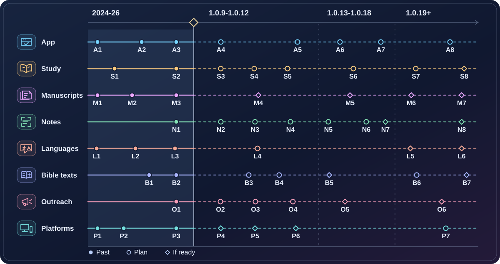

# Дорожная карта Revelation

**Состояние на 14.11.2026 · опубликована [1.0.8+178](https://github.com/karnauhov/Revelation/releases/tag/v1.0.8%2B178) · следующий выпуск 1.0.9.**

Revelation начинался как каталог рукописей и вырос в приложение для чтения Библии и изучения её текста. Следующая цель - сделать доступными законченные разборы книги Откровение, сохраняя связь каждого вывода с текстом, рукописями и контекстом. Новые функции, материалы и переводы могут выходить с разной скоростью.

Под схемой перечислены результаты и планы для каждого кода: A - приложение (App), S - исследование (Study), M - рукописи (Manuscripts), N - разметка (Notes), L - языки (Languages), B - библейские тексты (Bible texts), O - продвижение (Outreach), P - платформы (Platforms). Слева направо: пройденный путь, ближайшие выпуски до 1.0.12, развитие инструментов в 1.0.13-1.0.18 и дальний горизонт. Колонки обозначают этапы; расстояния между точками не выражают время или процент готовности.

<!-- roadmap milestones: start -->

## Что означает каждый узел

### A · Приложение

-  **A1** · 1.0.1: просмотр страниц рукописей с панелью и масштабом на Web и Windows.
-  **A2** · 1.0.5: интерактивные стихи и переходы от стиха к слову на факсимиле.
-  **A3** · 1.0.7: поиск по Библии, параллельное чтение и отдельный словарь Стронга.
-  **A4** · 1.0.9: искать ветхозаветные аллюзии и восстанавливать место чтения (REV113, REV212).
-  **A5** · 1.0.12: скачивать комплект данных и читать без сети (REV197, REV149-REV151).
-  **A6** · 1.0.14: показывать части речи и части предложения в слоях рукописи (REV156, REV157).
-  **A7** · 1.0.18: показывать иллюстрации к абзацам и предусмотреть управление с клавиатуры или пульта (REV163, REV161).
-  **A8** · 1.0.19: добавить оригиналы греческих и еврейских словарных статей Стронга (REV135, REV232).

### S · Исследование

-  **S1** · 1.0.0: вышло предисловие о первоисточниках, принципах и этапах изучения.
-  **S2** · К 1.0.8: в каталоге есть введение к Откровению 1:1-3; полный семиэтапный разбор ещё предстоит.
-  **S3** · 1.0.9: подготовить образец Откровения 1:1-3 и проверить формат с поиском аллюзий (REV213).
-  **S4** · 1.0.10: выпустить первый полный пакет 1:1-3 после всех семи фаз и проверки (REV242).
-  **S5** · 1.0.11: завершить полный пролог 1:1-8 с сопутствующими материалами (REV246).
-  **S6** · 2027-2029: публиковать проверенные послания семи церквям по одному или небольшими группами (REV3).
-  **S7** · 2029-2032: после посланий выпускать разборы печатей и труб небольшими пакетами (REV3).
-  **S8** · С 2032: после труб перейти к заключительному кризису и чашам, затем к царству, Новому Иерусалиму и эпилогу (REV3).

### M · Добавление рукописей

-  **M1** · 1.0.1: добавлены первые девять наборов изображений, включая U001 и P018.
-  **M2** · 1.0.2: добавлены 93 изображения U051.
-  **M3** · 1.0.7: добавлены изображения U207, U229 и P098.
-  **M4** · 1.0.10-1.0.12: зарегистрировать до двух новых источников по мере получения материалов и прав (REV145, REV153).
-  **M5** · 1.0.14-1.0.16: проверить ещё один слот и двух кандидатов INTF 20325/20326 (REV168, REV169).
-  **M6** · 1.0.23: включить факсимиле U025 после оцифровки, проверки страниц и разрешения (REV5, REV140, REV159).
-  **M7** · 1.1.x: получить и зарегистрировать изображения U052; количество уточнить по описи (REV5, REV228).

### N · Разметка страниц

-  **N1** · К 1.0.8: на трёх страницах U001/U002/U004 есть 156 размеченных слов, 154 номера Стронга и 8 стиховых областей.
-  **N2** · 1.0.9: полностью проверить P018/P098 и дополнить три начатые страницы в пилоте W00 (REV218).
-  **N3** · 1.0.10: разметить 18 изображений восьми малых фрагментов целиком (REV219).
-  **N4** · 1.0.11-1.0.12: закончить P115/U001 и P047/U002, включая уже начатые страницы (REV220, REV221).
-  **N5** · 1.0.13: закончить 16 изображений U004 (REV222).
-  **N6** · 1.0.14-1.0.16: разметить все 93 изображения U051 тремя партиями по 31 (REV223-REV225).
-  **N7** · 2030 при доступе и правах: разметить 39 изображений U046 в окнах 1.0.17-1.0.18, с выпуском по готовности (REV226).
-  **N8** · После регистрации страниц: разметить U025 и U052; опись даст объём и срок (REV227, REV228).

### L · Локализация

-  **L1** · 1.0.0: интерфейс на английском, украинском и русском.
-  **L2** · 1.0.3: добавлен испанский интерфейс.
-  **L3** · 1.0.4: статьи греческого словаря Стронга на четырёх языках.
-  **L4** · 1.0.10-1.0.11: проверять en/es/uk/ru вместе с первыми полными разборами.
-  **L5** · 1.1.x: выбрать следующий язык по спросу, готовности интерфейса и разрешённого перевода Библии (REV208).
-  **L6** · Дальнейшие языковые волны: расширять географию после пилота, проверяя контент и возможность сопровождения каждой локали.

### B · Библейские модули

-  **B1** · 1.0.7: выпущены английский KJV и греческий LXX/TR.
-  **B2** · 1.0.8: выпущен украинский OH1988 со сносками; Strong ведётся отдельно.
-  **B3** · 1.0.10: выпустить русский текстовый модуль после проверки конкретной редакции (REV202).
-  **B4** · 1.0.11: выпустить испанский текстовый модуль после проверки конкретной редакции (REV203).
-  **B5** · После русского и испанского модулей: выбрать один следующий перевод и подготовить ограниченный текстовый пилот (REV217).
-  **B6** · 1.0.20-1.0.22: сверить TR, KJV и LXX с печатными изданиями и добавить сноски (REV180, REV194, REV196).
-  **B7** · 1.1.x: выпускать проверенные слои Strong для OH1988 и будущих русской и испанской Библий по мере завершения отдельных исследований (REV229-REV231).

### O · Продвижение

-  **O1** · 1.0.8: открыт минутный пример украинского чтения на сайте; кампания идёт (REV235).
-  **O2** · 1.0.9: разобрать результаты украинской кампании после полного 14-дневного окна (REV235).
-  **O3** · 1.0.10: улучшить путь обратной связи для читателя (REV216).
-  **O4** · 1.0.12: сравнить соцсети и выбрать до двух каналов для пилота (REV177).
-  **O5** · После полного пролога: проверить его с небольшой группой; обращаться к OneVoice27 только после успешного пилота (REV214, REV304).
-  **O6** · Дальний горизонт: проводить языковые и региональные кампании по фактическому интересу и результатам предыдущих запусков.

### P · Платформы и инфраструктура

-  **P1** · 1.0.0: первый выпуск на Android.
-  **P2** · 1.0.1-1.0.3: запущены Web, Windows и Linux/Snap.
-  **P3** · 1.0.8: проверена доставка через сайт и магазины с локальной сборкой и приёмкой.
-  **P4** · 1.0.9: подготовить подпись Windows и её использование в локальной сборке (REV165, REV167).
-  **P5** · С 1.0.10: подготовить версии iOS и macOS к проверке Apple; Galaxy Store зависит от готовности площадки (REV123, REV154, REV160).
-  **P6** · 1.0.11-1.0.12: проверить условия AppGallery, F-Droid и Flathub и публиковать после готовности (REV146, REV141, REV147).
-  **P7** · 1.1.x: поддерживать воспроизводимые сборки, локальную приёмку и проверку производительности (REV144, REV133).

<!-- roadmap milestones: end -->

## Пройденный путь

| Версия и дата | Главное изменение |
| --- | --- |
| [Начало проекта](https://github.com/karnauhov/Revelation/commit/4a4706b) · 21.12.2024 | Первый коммит, основа Flutter и каталог первоисточников. |
| [1.0.0+27](https://github.com/karnauhov/Revelation/tree/v1.0.0%2B27) · 29.03.2025 | Android, предисловие, каталог 7 папирусов и 12 унциалов, английский, украинский и русский интерфейсы. |
| [1.0.1+69](https://github.com/karnauhov/Revelation/compare/v1.0.0%2B27...v1.0.1%2B69) · 02.05.2025 | Web и Windows, просмотр страниц, первые девять наборов факсимиле и версии изображений для мобильного браузера. |
| [1.0.2+80](https://github.com/karnauhov/Revelation/compare/v1.0.1%2B69...v1.0.2%2B80) · 31.05.2025 | Изображения U051, настройки обработки изображения и сохранение состояния страницы. |
| [1.0.3+113](https://github.com/karnauhov/Revelation/compare/v1.0.2%2B80...v1.0.3%2B113) · 04.07.2025 | Linux/Snap, испанская локализация, P085, новые дизайн и настройки. |
| [1.0.4+134](https://github.com/karnauhov/Revelation/compare/v1.0.3%2B113...v1.0.4%2B134) · 22.02.2026 | SQLite, греческий словарь Стронга на четырёх языках, слои слов и номеров, изображения U002 и P043. |
| [1.0.5+146](https://github.com/karnauhov/Revelation/compare/v1.0.4%2B134...v1.0.5%2B146) · 28.03.2026 | Стихи и переходы к словам на факсимиле, редактор контента, отдельные обновления данных, перестройка приложения. |
| [1.0.6+156](https://github.com/karnauhov/Revelation/compare/v1.0.5%2B146...v1.0.6%2B156) · 02.05.2026 | Кэширование изображений, сравнение слов рукописей, расширенный Markdown и экспорт. |
| [1.0.7+172](https://github.com/karnauhov/Revelation/compare/v1.0.6%2B156...v1.0.7%2B172) · 18.07.2026 | Чтение KJV и LXX/TR, поиск и параллельные панели, отдельный словарь, U207/U229/P098 и диагностика ошибок. |
| [1.0.8+178](https://github.com/karnauhov/Revelation/compare/v1.0.7%2B172...v1.0.8%2B178) · 14.11.2026 | Украинская Библия Огиенко 1988 со сносками, устойчивее запуск и обновление модулей, локальный процесс сборки и приёмки, старт кампании украинского чтения. |

Даты выпусков взяты из [истории изменений](CHANGELOG.md), коммиты и точные сборки - из Git. Метка сборки и дата выхода могут отличаться: у 1.0.0 дата первого выпуска предшествует тегу финальной сборки +27; у 1.0.8 исходный коммит сборки датирован 08.11, выпуск состоялся 14.11. Срез: 859 достижимых коммитов до [3f17dfd](https://github.com/karnauhov/Revelation/commit/3f17dfd72c5d264b483e98bd19ef98259100b655) включительно. Ссылки сравнения открывают историю изменений между сборками; [после сборки +178](https://github.com/karnauhov/Revelation/compare/v1.0.8%2B178...3f17dfd72c5d264b483e98bd19ef98259100b655) в Git отражены публикация и старт украинской кампании.

## Ближайшие и будущие версии

Номера и основной объём взяты из живого плана проекта. Окна ниже уже включают **10% резерва**. Разовая база первого прогноза: 12 недель для 1.0.9, по 16 недель для 1.0.10-1.0.12, 17 недель для 1.0.13 и около 22 недель на каждый дальнейший крупный выпуск. С резервом это примерно 13, 18, 19 и 24 недели. Суммируем от 14.11.2026 и округляем до сезона или полугодия. Это ориентиры: предыдущие два выпуска заняли около 2,5 и 4 месяцев, а темп полной разметки и разбора ещё предстоит измерить. Права на изображения, доступ к платформам и модерация могут менять окна независимо от резерва. Правки версий и переносы задач согласуются отдельно.

| Версия · ориентир | Функции и модули | Исследование · рукописи | Продвижение · платформы |
| --- | --- | --- | --- |
| **1.0.9** · зима 2026/27 | Поиск аллюзий, чтение и восстановление позиции; исправления звука и просмотра изображений | Образец 1:1-3; пилот W00 | Итоги украинской кампании; показ поиска и чтения; подготовка подписания Windows |
| **1.0.10** · весна-лето 2027 | Русская Библия; произношение и показ слов из введения | Полный пакет 1:1-3; W01; один дополнительный источник при готовности | Обратная связь; подготовка Apple и Galaxy Store |
| **1.0.11** · осень 2027 | Испанская Библия; оценка показа выделений в тексте | Полный пролог 1:1-8; W02 | Показ испанского чтения; оценка Huawei AppGallery |
| **1.0.12** · зима 2027/28 | Скачиваемый комплект для офлайна и проверка автономности; выбор следующего текстового модуля | Следующий законченный отрывок, пилот полного пролога; W03; ещё один источник | До двух каналов для пилота; OneVoice27 после успешной проверки пролога; оценка F-Droid и Flathub |
| **1.0.13** · I пол. 2028 | Еврейский словарь Стронга | Следующий пакет; W04 | Показ нового сценария |
| **1.0.14** · II пол. 2028 | Части речи и предложения в слоях рукописи | Следующий пакет; U051, 1-31; ещё один источник | Показ грамматических слоёв |
| **1.0.15** · I пол. 2029 | Связи отрывков и проверенные аллюзии | Следующий пакет; U051, 32-62 | Показ связей с другими книгами |
| **1.0.16** · II пол. 2029 | Структура книги, историческая справка, практическая вера, первая карта географии Откровения | Следующий пакет; U051, 63-93; оценка двух новых кандидатов | Показ одного сценария исследования |
| **1.0.17** · I пол. 2030 | Озвучивание чтения и управляемая фоновая музыка | Следующий пакет; начать U046 при наличии прав | Показ доступного чтения |
| **1.0.18** · II пол. 2030 | Иллюстрации, просмотр связанных материалов, навигация с клавиатуры/пульта | Следующий пакет; продолжить U046 | Показ визуального изучения |
| **1.0.19** · I пол. 2031 | Оригиналы греческих и еврейских статей Стронга | Следующий пакет | Показ словаря |
| **1.0.20** · II пол. 2031 | Сверка TR с печатными изданиями, сноски | Следующий пакет | Показ проверенного текста |
| **1.0.21** · I пол. 2032 | Сверка KJV, сноски и просмотр печатного оригинала при наличии прав | Следующий пакет | Показ источников перевода |
| **1.0.22** · II пол. 2032 | Сверка LXX, сноски и просмотр печатного оригинала при наличии прав | Следующий пакет | Показ работы с греческим текстом |
| **1.0.23** · 2033 | Факсимиле Порфирианского кодекса U025 при наличии материалов и прав | Следующий пакет; сверка транскрипции U025 | Показ принятого факсимиле |
| **1.1.x** · с 2033, по готовности | Сравнение редакций, распознавание и обработка изображений, карты НЗ/ВЗ, хронология, дневник и община по спросу | Остальные отрывки и рукописи; отдельные программы Strong | Новые языки и география продвижения, устойчивость сопровождения |

Каждому программному выпуску предшествует приёмка. Дополнительные витрины, права на факсимиле и новые исследования имеют собственные условия готовности. Данные, завершённые раньше, могут выйти между версиями приложения; полнота разбора одного отрывка не зависит от наличия всех будущих функций.

## Исследование: законченные отрывки

Предисловие и введение 1:1-3 уже есть. Образец в 1.0.9 показывает формат и поиск; первым полным пакетом планируется 1:1-3 в окне 1.0.10, затем весь пролог 1:1-8. Всю книгу выпускаем последовательно небольшими законченными отрывками. В каждом пакете:

1. Сводный текст по доступным свидетелям, варианты чтения и ссылки на страницы.
2. Слова, проверенные номера Стронга, грамматика и синтаксис.
3. Ветхозаветные аллюзии с аргументами и первичными ссылками.
4. Связь с личностью, жизнью и служением Иисуса Христа.
5. Место отрывка в структуре книги, связи с Даниилом и другими текстами Библии по существу.
6. Исторический контекст и обоснованная оценка возможного исполнения пророчеств.
7. Вопросы и практическое применение для читателя.

К каждому пакету - краткое и подробное чтение, источники, ссылки на Библию и факсимиле, словарь, схемы, изображения и другие поясняющие материалы по необходимости. Доступность и права на дополнительные материалы проверяются. Перед публикацией сверяем en/es/uk/ru, ссылки и основания выводов; отмечаем, что подтверждено, что является интерпретацией и что осталось спорным. Агент может подготовить черновик, сопоставить свидетельства и проверить ссылки. Предметная проверка и обратная связь читателей помогают там, где они добавляют ценность.

| Часть книги | Окно работы и последовательной публикации |
| --- | --- |
| Пролог · 1:1-8 | 2027: первый полный пакет 1:1-3 и завершение пролога; проверка с группой после его готовности. |
| Семь церквей · 1:9-3:22 | 2027-2029: вступление и послания отдельными пакетами. |
| Печати · 4:1-8:1; трубы · 8:2-11:18 | 2029-2032: сначала печати, затем трубы, несколькими пакетами. |
| Заключительный кризис · 11:19-15:4; чаши · 15:5-18:24 | С 2032: по завершении предыдущих частей. |
| Царство · 19:1-20:15; Новый Иерусалим · 21:1-22:5; эпилог · 22:6-21 | Дальний горизонт 1.1.x: по очереди после чаш. |

Для исследования на дальнем горизонте заложен условный темп в несколько принятых небольших пакетов в год; оценку всей книги уточним после пролога и первых посланий. Большие главы разбиваются по содержанию, поэтому дата полного завершения пока открыта (REV2, REV3, REV207, REV213, REV242, REV246).

## Добавление первоисточников

В каталоге 19 рукописей, для просмотра изображений включены 16. Первыми проверяем доступ и права на U046, U025 и U052: для U046 нужны разрешённые файлы и атрибуция; для U025 и U052 сначала нужны факсимиле и опись страниц Откровения. Объём средств и срок поставки зависят от условий держателей. Задачи общих слотов 1.0.10, 1.0.12 и 1.0.14 ещё не закреплены за конкретными рукописями. На горизонт 1.0.16 есть ещё два [кандидата INTF: 20325](https://ntvmr.uni-muenster.de/manuscript-workspace?docID=20325) и [20326](https://ntvmr.uni-muenster.de/manuscript-workspace?docID=20326); состав страниц и условия использования ещё не подтверждены (REV5, REV145, REV153, REV168, REV169).

## Изображения и разметка по источникам

В опубликованном каталоге [SQLite](web/db/revelation.sqlite) (схема 4, данные 11) **232 уникальных записи изображений**: 193 с включённым показом и 39 в закрытой части U046. Считаем оригинальные записи страниц, без превью и мобильных копий; включённый показ означает настройку каталога, отдельная доступность файлов проверяется при приёмке пакета. В трёх изображениях есть частичная разметка: 156 слов (154 с номерами Стронга) и 8 интерактивных стиховых областей. Регистрируем полную страницу только после проверки её содержимого.

| Источник | Изображения · разметка сейчас | Завершение полного контекста |
| --- | --- | --- |
| P018 · папирус 18 | 1 · нет | W00 · 1.0.9, зима 2026/27 |
| P024 · папирус 24 | 2 · нет | W01 · 1.0.10, весна-лето 2027 |
| P043 · папирус 43 | 2 · нет | W01 · 1.0.10, весна-лето 2027 |
| P047 · папирус 47 | 20 · нет | W03 · 1.0.12, зима 2027/28 |
| P085 · папирус 85 | 2 · нет | W01 · 1.0.10, весна-лето 2027 |
| P098 · папирус 98 | 1 · нет | W00 · 1.0.9, зима 2026/27 |
| P115 · папирус 115 | 8 · нет | W02 · 1.0.11, осень 2027 |
| U001 · Синайский | 18 · 1 частично, 64 слова | 325v в W00; все 18 в W02 · 1.0.11, осень 2027 |
| U002 · Александрийский | 18 · 1 частично, 59 слов | 150r в W00; все 18 в W03 · 1.0.12, зима 2027/28 |
| U004 · Ефремов | 16 · 1 частично, 33 слова | 197r в W00; все 16 в W04 · 1.0.13, I пол. 2028 |
| U025 · Порфирианский | 0 в каталоге · итог неизвестен | W09 после получения прав и описи; ориентир поступления 1.0.23 (2033), срок разметки уточняется после описи |
| U046 · Ватиканский 2066 | 39 записей · показ закрыт | W08 · 1.0.17-1.0.18, 2030 при наличии материалов и прав |
| U051 · Пантократорский | 93 · нет; у 10 страниц уточнить содержание | W05: 1-31 · II пол. 2028; W06: 32-62 · I пол. 2029; W07: 63-93 · II пол. 2029 |
| U052 · Пантелеимонов | 0 в каталоге · итог неизвестен | W10 · горизонт 1.1.x, после прав, оцифровки и описи; дата открыта |
| U163 · унциал 0163 | 2 · нет | W01 · 1.0.10, весна-лето 2027 |
| U169 · унциал 0169 | 2 · нет | W01 · 1.0.10, весна-лето 2027 |
| U207 · унциал 0207 | 2 · нет | W01 · 1.0.10, весна-лето 2027 |
| U229 · унциал 0229 | 4 · нет | W01 · 1.0.10, весна-лето 2027 |
| U308 · унциал 0308 | 2 · нет | W01 · 1.0.10, весна-лето 2027 |
| Новые кандидаты вне каталога | Нет подтверждённой описи | При поступлении: опись, оценка трудоёмкости, затем окно разметки |

**Готовая страница:** источник, лист/сторона, права и атрибуция изображения; главы и стихи с границами; транскрипция, порядок слов, координаты и переходы; доказанные номера Стронга; различение библейского текста, заголовков, катены, правок и нечитаемых мест. Грамматический слой добавляется по готовности функции. Неясные слова остаются с явным статусом; транскрипцию и геометрию можно выпускать до разрешения спорных номеров. Пилот W00 проверяет пять страниц (три уже начаты): после него пересчитать W01/W02 по принятым страницам, времени сверки и возвратам. Страницы, входящие в пилот и полный пакет, считаются один раз (REV206, REV218-REV228).

## Локализации и переводы материалов

Сегодня поддерживаем en, es, uk и ru: интерфейс, тексты справки, словарь и новые разборы. Пополняем четыре действующие локали в каждом пакете. Следующий язык выбираем по запросам, наличию разрешённого библейского текста и возможности поддерживать переводы интерфейса и материалов. Агенты ускоряют черновики и общую сверку терминов; выборочную вычитку и отзывы организуем по необходимости.

В долгую сохраняем идею широкого географического охвата: пилоты для востребованных европейских языков, затем расширение в Азии, Африке, Америке, Австралии и Океании, включая неевропейские языки этих регионов и языки небольших сообществ. Это возможная последовательность волн; выбор конкретных языков не привязан к главам Откровения и уточняется по спросу и готовности (REV208).

## Библейские модули

| Локаль | Первый перевод | Состояние |
| --- | --- | --- |
| en | KJV | Выпущен в 1.0.7; печатная сверка в 1.0.21 |
| uk | Огиенко, издание 1988 года | Выпущен в 1.0.8 со сносками; Strong - отдельное исследование |
| ru | Русский перевод, редакция после проверки | Текстовый модуль в 1.0.10 |
| es | Испанский перевод, редакция после проверки | Текстовый модуль в 1.0.11 |

Греческий LXX/TR уже доступен для сравнения; печатная сверка TR и LXX относится к 1.0.20 и 1.0.22. После русского и испанского текстов планируем один следующий пилот. Для каждой новой локали цель - хотя бы один проверенный перевод на её языке. Сначала сверяем издание и права, полноту и нумерацию текста, сноски и работу в приложении. Исследования Strong для украинского, русского и испанского идут отдельно (REV125, REV217, REV229-REV231). Подробнее: [украинская разметка](docs/ru/content/ukrainian-bible-strongs-module-roadmap.ru.md) и [русская разметка](docs/ru/content/rst-strongs-module-roadmap.ru.md).

## Продвижение и обратная связь

Сначала показываем одну реальную пользу выпуска коротким примером на сайте и в магазинах. [Украинский пример 1.0.8](https://www.revelation.website/demo/uk-reading.html) уже открыт; итог 14-дневного измерения ожидается после 28.11.2026. Смотрим на путь первого чтения, возвраты и обратную связь. Для 1.0.12 - сравнить соцсети, выбрать до двух стартовых каналов, затем проверить полный пролог с небольшой группой. Возможный контакт с OneVoice27 - отдельный шаг после успешного пилота.

В долгую - органические публикации и локальные кампании для аудиторий Северной и Южной Америки, Европы, Азии, Африки и Океании. Приоритет выбираем по готовому материалу, языку, интересу и результатам предыдущего цикла. Агенты помогают готовить материалы и сравнивать результаты; вклад людей полезен для отзывов, вычитки и проведения групп. Аккаунты, размещения, платное продвижение и партнёрства требуют отдельного решения (REV177, REV214, REV235, REV304).

## Платформы и инфраструктура

Публичные площадки сейчас: [Web](https://www.revelation.website), [Android/Google Play](https://play.google.com/store/apps/details?id=ai11.link.revelation), [Windows/Microsoft Store](https://apps.microsoft.com/detail/9NXHRR2P4087), [Linux/Snap](https://snapcraft.io/revelation-x) и [архив сборок GitHub](https://github.com/karnauhov/Revelation/releases). Подпись Windows, отдельные шаги для Apple, Galaxy Store, AppGallery, F-Droid и Flathub оцениваются по готовности сборок, условиям площадки и возможности сопровождения. Постоянная работа - локальная приёмка, воспроизводимые сборки, проверенные копии данных, диагностика, доступность и производительность (REV144).

## Как поддерживается план

Это общая карта проекта. Очередь задач и её статусы остаются в AI11; технические планы модулей и исторические доказательства дополняют карту. После каждого подтверждённого выпуска обновляем историю, сверяем прогресс всех направлений и синхронизируем инфографику и четыре демо.

Для следующего расчёта сохраняем первоначальную базу, исходное окно с резервом, дату начала и фактическую дату выпуска. Сравниваем календарные интервалы; отдельно учитываем активное время за вычетом явных пауз, приёмку и ожидание публикации. По отклонениям и скорости сопоставимой работы пересматриваем базу будущих версий и добавляем 10% один раз. Прежние оценки не переписываем задним числом. Обновления данных между релизами отражаем по факту.

| Выпуск | Зафиксированный прогноз | Факт и отклонение |
| --- | --- | --- |
| 1.0.9 | От 14.11.2026: 12 недель × 1,10; ориентир середина февраля 2027 | Дополнить после выпуска |

Основание первого среза - 25 групп версий AI11 (1.0.0-1.0.23 и очередь 1.1.n), 310 существовавших задач, включая 4 общие вне версий, [Git и история выпусков](CHANGELOG.md), [манифест данных](web/db/manifest.json) и фактические записи каталога.
