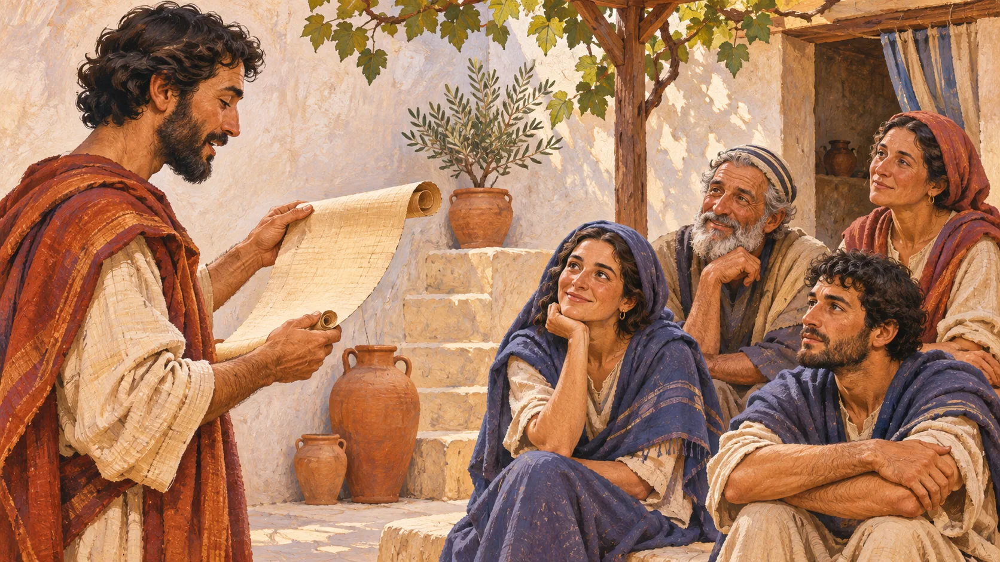
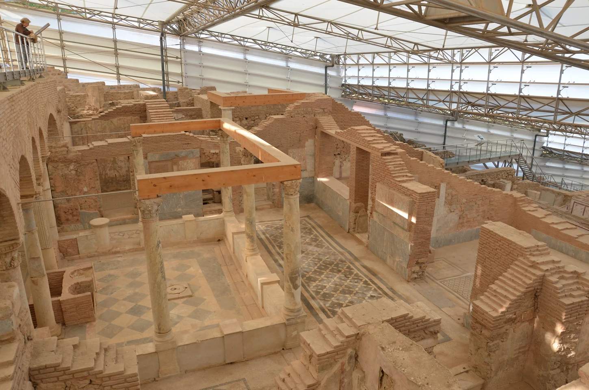

Try reading the first three verses with someone. One of you reads aloud while the other listens with the book closed. By the end of verse 3, both of you will have heard yourselves mentioned. [Rev. 1:1-3](bible:Rev1:1:3)

An illustration inspired by Revelation 1:3.

| Verse | Follow the message |
| --- | --- |
| 1:1 | God gives the revelation to Jesus Christ. An angel brings it to John so that others, too, can learn what is to happen. |
| 1:2 | John tells what he saw. Someone else can now hear his account of the word of God and the testimony of Jesus Christ. |
| 1:3 | One person reads and many listen. When the reading ends, the blessing stays with those who keep what they heard and act on it. |

If you are reading the verse aloud, you reach the word “blessed” and discover that you are reading about yourself. Who are the next words about? Swap roles and read the verse again. [Rev. 1:3](bible:Rev1:3)

What would it mean to keep what you heard today? Perhaps, as you read, you thought of someone you promised to call a while ago. Start with that call. Then ask each other which word from these verses you would like to take with you, and why. [James 1:22](bible:Jas1:22) · [John 14:15](bible:John14:15)

<!-- study:deeper -->

Select a linked Greek word to compare the manuscripts. In the main reading of [Revelation 1:3](bible:Rev1:3), one person reads and many listen. The text below brings together the readings compared in the app. The critical edition also records a reading in which both the readers and the listeners are plural.¹

#### Primary sources

- `01` [Codex Sinaiticus](word:U001)
- `02` [Codex Alexandrinus](word:U002)
- `04` [Codex Ephraemi Rescriptus](word:U004)
- `046` [Codex Vaticanus 2066](word:U046)
- `025` [Codex Porphyrianus](word:U025)

#### Consolidated variant text

Below is not a "reconstructed final text", but rather a general composite text into which all actually attested variations are incorporated.

**Rev. 1:1**
[ΑⲠⲞⲔΑⲖⲨⲯⲒⲤ](words:U001:325v:2;U002:150r:0;U046;U025) [Ⲓ̅Ⲩ̅](words:U001:325v:3;U002:150r:1;U046;U025) [Ⲭ̅Ⲩ̅](words:U001:325v:4;U002:150r:2;U046;U025) [ⲎⲚ](words:U001:325v:5;U002:150r:3;U046;U025) [ⲈⲆⲰⲔⲈⲚ](words:U001:325v:6;U002:150r:4;U046;U025) **❗{ [ΑⲨⲦⲰ](words:U001:325v:7;U002:150r:5;U025) | ΑⲨⲦⲎ }** [Ⲟ](words:U001:325v:8;U046;U025) [Ⲑ̅Ⲥ̅](words:U001:325v:9;U046;U025) [ⲆⲈⲒⲜΑⲒ](words:U001:325v:10;U002:150r:6;U046;U025) [ⲦⲞⲒⲤ](words:U001:325v:11;U002:150r:7;U046;U025) **❗{ [ΑⲄⲒⲞⲒⲤ](words:U001:325v:12) | [ⲆⲞⲨⲖⲞⲒⲤ](words:U002:150r:8;U046;U025) }** [ΑⲨⲦⲞⲨ](words:U001:325v:14;U002:150r:9;U046;U025) [Α](words:U001:325v:15;U002:150r:10;U046;U025) [ⲆⲈⲒ](words:U001:325v:16;U002:150r:11;U046;U025) [ⲄⲈⲚⲈⲤⲐΑⲒ](words:U001:325v:17;U002:150r:12;U046;U025) [ⲈⲚ](words:U001:325v:18;U002:150r:13;U046;U025) [ⲦΑⲬⲈⲒ](words:U001:325v:19;U002:150r:14;U046;U025) [ⲔΑⲒ](words:U001:325v:20;U002:150r:15;U046;U025) [ⲈⲤⲎΜΑⲚⲈⲚ](words:U001:325v:21;U002:150r:16;U046;U025) [ΑⲠⲞⲤⲦⲈⲒⲖΑⲤ](words:U001:325v:22;U002:150r:17;U046;U025) [ⲆⲒΑ](words:U001:325v:23;U002:150r:18;U046;U025) [ⲦⲞⲨ](words:U001:325v:24;U002:150r:19;U046;U025) [ΑⲄⲄⲈⲖⲞⲨ](words:U001:325v:25;U002:150r:20;U046;U025) [ΑⲨⲦⲞⲨ](words:U001:325v:26;U002:150r:21;U046;U025) **❗{ [ⲦⲰ](words:U001:325v:27;U046;U025) [ⲆⲞⲨⲖⲰ](words:U001:325v:28;U046;U025) | [ⲦⲞⲨ](words:U002:150r:22) [ⲆⲞⲨⲖⲞⲨ](words:U002:150r:23) }** [ΑⲨⲦⲞⲨ](words:U001:325v:29;U002:150r:24;U046;U025) **❗{ [ΪⲰΑⲚⲈⲒ](words:U001:325v:30) | [ΪⲰΑⲚⲚⲎ](words:U002:150r:25;U046;U025) }**

**Rev. 1:2**
[ⲞⲤ](words:U001:325v:31;U002:150r:26;U004:197r:0;U046;U025) **❗{ [ⲈΜΑⲢⲦⲨⲢⲎⲤⲈⲚ](words:U001:325v:32;U002:150r:27;U004:197r:1;U046) | ⲈΜΑⲢⲦⲨⲢⲒⲤⲈⲚ }** [ⲦⲞⲚ](words:U001:325v:33;U002:150r:28;U004:197r:2;U046;U025) [ⲖⲞⲄⲞⲚ](words:U001:325v:34;U002:150r:29;U004:197r:3;U046;U025) [ⲦⲞⲨ](words:U001:325v:35;U002:150r:30;U004:197r:4;U046;U025) [Ⲑ̅Ⲩ̅](words:U001:325v:36;U002:150r:31;U004:197r:5;U046;U025) [ⲔΑⲒ](words:U001:325v:37;U002:150r:32;U004:197r:6;U046;U025) [ⲦⲎⲚ](words:U001:325v:38;U002:150r:33;U004:197r:6;U046;U025) [ΜΑⲢⲦⲨⲢⲒΑⲚ](words:U001:325v:39;U002:150r:34;U004:197r:7;U046;U025) [Ⲓ̅Ⲩ̅](words:U001:325v:40;U002:150r:35;U004:197r:8;U046;U025) [Ⲭ̅Ⲩ̅](words:U001:325v:41;U002:150r:36;U004:197r:9;U046;U025) [ⲞⲤΑ](words:U001:325v:42;U002:150r:37;U004:197r:10;U046;U025) **❗{ [ΪⲆⲈ](words:U001:325v:43) | [ΪⲆⲈⲚ](words:U002:150r:38;U046) | [ⲈⲒⲆⲈⲚ](words:U004:197r:11;U025) }**

**Rev. 1:3**
[ΜΑⲔΑⲢⲒⲞⲤ](words:U001:325v:44;U002:150r:39;U004:197r:12;U046;U025) [Ⲟ](words:U001:325v:45;U002:150r:40;U004:197r:13;U046;U025) [ΑⲚΑⲄⲒⲚⲰⲤⲔⲰⲚ](words:U001:325v:46;U002:150r:41;U004:197r:14;U046;U025) [ⲔΑⲒ](words:U001:325v:47;U002:150r:42;U004:197r:15;U046;U025) [ⲞⲒ](words:U001:325v:48;U002:150r:43;U004:197r:16;U046;U025) [ΑⲔⲞⲨⲞⲚⲦⲈⲤ](words:U001:325v:49;U002:150r:44;U004:197r:17;U046;U025) **❗{ [ⲦⲞⲚ](words:U001:325v:50;U046) [ⲖⲞⲄⲞⲚ](words:U001:325v:51;U046) | [ⲦⲞⲨⲤ](words:U002:150r:45;U025) [ⲖⲞⲄⲞⲨⲤ](words:U002:150r:46;U025) | [ⲦⲞⲨⲤ](words:U004:197r:18) [ⲖⲞⲄⲞⲨⲤ](words:U004:197r:19) [ⲦⲞⲨⲦⲞⲨⲤ](words:U004:197r:20) }** [ⲦⲎⲤ](words:U001:325v:52;U002:150r:47;U004:197r:21;U046;U025) **❗{ [ⲠⲢⲞⲪⲎⲦⲒΑⲤ](words:U001:325v:53;U004:197r:22) | [ⲠⲢⲞⲪⲎⲦⲈⲒΑⲤ](words:U002:150r:48;U046;U025) }** [ⲔΑⲒ](words:U001:325v:54;U002:150r:49;U004:197r:23;U046;U025) [ⲦⲎⲢⲞⲨⲚⲦⲈⲤ](words:U001:325v:55;U002:150r:50;U004:197r:24;U046;U025) [ⲦΑ](words:U001:325v:56;U002:150r:51;U004:197r:25;U046;U025) [ⲈⲚ](words:U001:325v:57;U002:150r:52;U004:197r:26;U046;U025) [ΑⲨⲦⲎ](words:U001:325v:58;U002:150r:53;U004:197r:27;U046;U025) [ⲄⲈⲄⲢΑΜΜⲈⲚΑ](words:U001:325v:59;U002:150r:54;U004:197r:28;U046;U025) [Ⲟ](words:U001:325v:60;U002:150r:55;U004:197r:29;U046;U025) [ⲄΑⲢ](words:U001:325v:61;U002:150r:56;U004:197r:30;U046;U025) [ⲔΑⲒⲢⲞⲤ](words:U001:325v:62;U002:150r:57;U004:197r:31;U046;U025) [ⲈⲄⲄⲨⲤ](words:U001:325v:63;U002:150r:58;U004:197r:32;U046;U025)

In verse 3 the manuscripts let us hear both “the word” and “the words.” Now listen to the verbs. How does the message reach the people who hear it?

Notice who acts in each of these three verses. In the first, [God gives the revelation](bible:Rev1:1). In the second, [John bears witness](bible:Rev1:2). In the third, [one person reads and others listen and keep what they hear](bible:Rev1:3). With that sequence in mind, go back to the opening words.

### Verse 1. How did John find out?

The book opens with “[the revelation of Jesus Christ](bible:Rev1:1).” Its first Greek word, *[apokalypsis](strong:G602)*, means an unveiling here. Where does the message come from? God gave it to Jesus Christ for his servants. And what do we learn about Jesus himself? A few lines later he is called [the faithful witness and the firstborn from the dead](bible:Rev1:5). There John also speaks of Christ’s love for us. Listen again to the opening words. Who does the revealing? And who is revealed to the reader?

What prompted John to write? One priest draws attention to the connection between the commission John received on Patmos and the words of Christ addressed to each church in turn.² Listen to [the instruction in verse 11](bible:Rev1:11). John is to write down what he sees and send the book to seven churches. Now we know whom he is writing for.

“[What must take place](bible:Rev1:1)” has a familiar ring. The king of Babylon has had a dream. When he asks Daniel to explain it, Daniel speaks of [a God who reveals mysteries](bible:Dan2:28). The same three Greek words, [ἃ](strong:G3739) [δεῖ](strong:G1163) [γενέσθαι](strong:G1096) (“what must take place”), occur together in that verse and in [Revelation 1:1](bible:Rev1:1).³ In Daniel [the revelation is given to a king](bible:Dan2:45). Here the message is meant for God’s servants, and John adds “[soon](words:U001:325v:19;U002:150r:14).” The words and the scene give us reason to hear an echo of Daniel.

### Verse 2. What can a witness say?

John tells us how far his words reach. [He bore witness to what he saw](bible:Rev1:2). In Greek the verb “[bore witness](strong:G3140)” and the noun “[testimony](strong:G3141)” share a root and appear in the same short sentence. Listen for the echo. The story begins with God, but it reaches the listener through a human voice. John answers for what he tells us. Jesus himself is called [the faithful witness](bible:Rev1:5) a few lines later. As you read, first notice exactly what John saw. Then ask what it might mean. Which words in the passage point you toward that explanation?

A few lines later, John names [the island of Patmos](bible:Rev1:9) and once again puts [“the word of God” alongside “the testimony of Jesus”](bible:Rev1:2). At first we learn what John bore witness to. Now the same expressions are part of the story of his own life. Read both passages aloud. What changes when you know something about the life behind the voice?

What did John see that he was asked to write down? In [the opening vision](bible:Rev1:17:19), John falls at the feet of the one who speaks to him. The speaker tells John that he died and is alive for ever. Then he tells John to write what he has seen. When John calls Jesus the faithful witness, he can also tell his listeners what the living Christ said to him.

### Verse 3. What would you hear in the room?

Listen for the shift from one to many. In Greek, “[the one who reads](words:U001:325v:46;U002:150r:41;U004:197r:14)” is singular. “[Those who hear](words:U001:325v:49;U002:150r:44;U004:197r:17)” and “[those who keep](words:U001:325v:55;U002:150r:50;U004:197r:24)” are plural. It is easy to picture people gathered together. One person speaks the words aloud, and the others hear them and carry them away. The next verse names the first recipients, [the seven churches in Asia](bible:Rev1:4).

Ephesus comes first on the list of [the seven churches](bible:Rev1:11), and [the first message](bible:Rev2:1) is addressed to the church there. Where might Christians have gathered in a city like this? Paul tells the Corinthians that [he plans to stay in Ephesus for a while](bible:1Cor16:8). He sends greetings from Aquila, Prisca and [the church that meets in their house](bible:1Cor16:19). The photograph gives us a glimpse of homes in Roman Ephesus. Archaeologists date two houses in this complex to the early first century. Their rooms opened onto courtyards lined with columns.⁴

*Colonnaded courtyard in the complex of Roman terrace houses, Ephesus, Turkey. Photograph by shankar s., 2014, CC BY 2.0. Resized and converted to WebP.⁴*

In the early second century, Pliny, the Roman governor of Bithynia and Pontus in what is now northern Turkey, wrote to Emperor Trajan about people he had questioned. People he questioned said that Christians used to meet on a fixed day before dawn and sing a hymn to Christ. Those who continued to identify themselves as Christians could be punished.⁵ Think of John calling himself [a brother who shares in suffering and patient endurance](bible:Rev1:9). How might those words sound to people called to answer for their faith?

In the third century, one bishop paused over the words “[those who keep](strong:G5083).” As he saw it, people give close attention to reading so they can learn to do what the text asks of them.⁶ Try reading [the verse](bible:Rev1:3) once, leaving out the words about keeping what is written. Then put them back. What difference do they make to the listener?

| Manuscript and page in the Revelation app | How the phrase sounds in translation |
| --- | --- |
| Codex Sinaiticus, 325v: τὸν [λόγον](word:U001:325v:51) | “the word” of the prophecy |
| Codex Alexandrinus, 150r: τοὺς [λόγους](word:U002:150r:46) | “the words” of the prophecy |
| Codex Ephraemi Rescriptus, 197r: τοὺς [λόγους](word:U004:197r:19) τούτους | “these words” of the prophecy |

Compare what the listeners hear in each row: [“the word,” “the words,” or “these words”](words:U001:325v:51;U002:150r:46;U004:197r:19). What do they do with what they hear? Open “[those who keep](words:U001:325v:55;U002:150r:50;U004:197r:24)” and look for the same expression in all three manuscripts. In the lexicon, compare the article [τὸν / τοὺς](strong:G3588), the noun forms [λόγον / λόγους](strong:G3056), and the demonstrative [τούτους](strong:G3778) (“these”).

Long before John, Moses gave instructions to [read the law aloud](bible:Deut31:11) and [gather the people so they could hear it and learn to put it into practice](bible:Deut31:12). Revelation gives us a similar picture of faithfulness to the covenant. In Daniel [the book is sealed until the time of the end](bible:Dan12:4). At the close of Revelation John is told to [leave the words of the prophecy unsealed](bible:Rev22:10). Compare the two instructions. Which helps explain why the people gathered to hear John can already hear the blessing?

Listen for a similar blessing in [Luke 11:27-28](bible:Luke11:27:28). A woman in the crowd calls the mother of Jesus blessed. Jesus answers that those who hear God's word and keep it are blessed. Now return to the people listening in [Revelation 1:3](bible:Rev1:3). What can they do once the reading is over?

### Why say “the time is near”?

John uses two different expressions. In [verse 1](bible:Rev1:1), “soon” goes with what must happen. In [verse 3](bible:Rev1:3), it is the time itself that John calls “near.” Read the little word “for” before that last phrase. How does it explain why keeping what they have heard matters to the listeners now?

Turn to the closing lines of the book. We meet [the angel and the servants again and hear once more of what must soon take place](bible:Rev22:6). In the next verse [Christ’s promise to come soon](bible:Rev22:7) stands alongside a blessing on the person who keeps the words of the prophecy. By now the visions have passed before the reader’s eyes. How will the reader respond? What does John invite people to do when they hear that the time is near? The opening verses give no date. In the Gospel Jesus tells his disciples that [they do not know the day or the hour](bible:Mat24:36).

In [verse 3](bible:Rev1:3) we meet the first of seven blessings in Revelation.⁷ Find another in [19:9](bible:Rev19:9). There the blessing is for [those invited to the wedding supper of the Lamb](bible:Rev19:9). In [22:7](bible:Rev22:7) it is again for [the person who keeps the words of the book](bible:Rev22:7). Who comes to mind as you hear each of these promises?

A sixteenth-century preacher imagined a listener who thinks these events will concern only people in the distant future. He reminded the listener how the verse ends: “[the time is near](bible:Rev1:3).”⁸ What changes if you count yourself among those this book addresses today?

Read [the first three verses](bible:Rev1:1:3) again and finish the sentence “Today I heard…” in your own words. Ask each other [what one thing you could do in response](bible:Jas1:22). Next time you meet, begin by telling each other what happened after you read.

**[Try the search for parallels](screen:allusion_search).** Select [Revelation 1:1](bible:Rev1:1), a length of one verse, the Old Testament, and results by verse. In this index, [Genesis 24:7](bible:Gen24:7) comes first. In both passages God sends [an angel](words:U001:325v:25;U002:150r:20). In Abraham’s story, the angel goes ahead of the servant who has set out to find a wife for Isaac. Compare this with [Daniel 2:28](bible:Dan2:28). Which story helps you understand *the revealing of what is to come*? Here the search brings a shared image to light. Reading both stories helps you judge how much weight to give it.

<!-- study:references -->

---

1. [Institut für Neutestamentliche Textforschung. Novum Testamentum Graecum, Editio Critica Maior, VI/1, Revelation 1:3, positions 4-12](https://shop.die-bibel.de/media/bc/2c/b7/1733099623/ECM%20VI1.%20Offenbarung.%20Text.pdf.pdf#page=34)
2. [Thomas Hopko. The Orthodox Faith, vol. I, “Book of Revelation,” paragraph on John’s commission to the seven churches](https://www.oca.org/orthodoxy/the-orthodox-faith/doctrine-scripture/new-testament/book-of-revelation#:~:text=Saint%20John%20received%20his%20vision)
3. [R. Timothy McLay. A New English Translation of the Septuagint, “Daniel,” the two ancient Greek versions of Daniel 2:28, p. 997](https://ccat.sas.upenn.edu/nets/edition/40-daniel-nets.pdf#page=7)
4. [Ingrid Adenstedt. Terrace House 2 in Ephesus. Dwelling Units 3 and 5, Austrian Science Fund project description](https://www.fwf.ac.at/en/research-radar/10.55776/PUB1315). [shankar s., original photograph (2014)](https://commons.wikimedia.org/wiki/File:Overview_of_the_Terrace_houses_%2816314206402%29.jpg), [CC BY 2.0 licence](https://creativecommons.org/licenses/by/2.0/).
5. [Pliny the Younger. Letters, 10.96, §§3, 7, translated by J. B. Firth](https://www.attalus.org/pliny/ep10b.html#96). [Trajan’s reply, 10.97, §2](https://www.attalus.org/pliny/ep10b.html#97).
6. [Victorinus of Pettau. Commentary on the Apocalypse of the Blessed John, ch. I, §1, English translation](https://www.newadvent.org/fathers/0712.htm#:~:text=The%20beginning%20of%20the%20book%20promises%20blessing)
7. [New American Bible, Revised Edition. Note on the seven blessings at Revelation 1:3](https://bible.usccb.org/bible/revelation/1#74001003-1)
8. [Heinrich Bullinger. A Hundred Sermons upon the Apocalips of Iesu Christe, second sermon, English edition of 1561, pp. 17-18](https://earlyenglishprintedsermons.org/segment/B11837/298)
