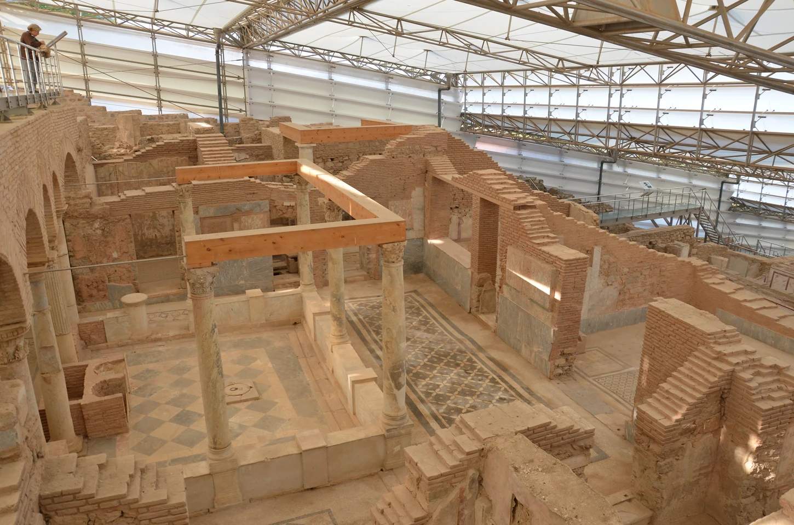

Попробуйте прочесть первые три стиха вдвоём. Пусть один читает вслух, а другой слушает с закрытой книгой. К концу третьего стиха оба услышат о себе. [Откр. 1:1-3](bible:Rev1:1:3)

Художественная иллюстрация к Откр. 1:3.

| Стих | Проследите путь вести |
| --- | --- |
| 1:1 | Бог даёт откровение Иисусу Христу. Через ангела оно доходит до Иоанна, чтобы и другие узнали, чему предстоит совершиться. |
| 1:2 | Иоанн рассказывает, что видел. Теперь его свидетельство о слове Божьем и свидетельстве Иисуса Христа может услышать другой человек. |
| 1:3 | Один читает, многие слушают. Когда чтение заканчивается, благословение остаётся с теми, кто хранит услышанное и поступает в согласии с ним. |

Человек, который читает стих вслух, доходит до слова «блажен» и обнаруживает, что читает о себе. А к кому обращены следующие слова? Поменяйтесь ролями и прочтите стих ещё раз. [Откр. 1:3](bible:Rev1:3)

Что значит сохранить услышанное сегодня? Если во время чтения вам вспомнился человек, которому вы давно обещали позвонить, начните с этого звонка. А потом спросите друг друга, какое слово из этих трёх стихов вам хочется унести с собой и почему. [Иак. 1:22](bible:Jas1:22) · [Ин. 14:15](bible:John14:15)

<!-- study:deeper -->

Нажмите на греческое слово со ссылкой, чтобы сравнить рукописи. В основном чтении [Откр. 1:3](bible:Rev1:3) один человек читает, а многие слушают. Свод ниже показывает чтения, сопоставленные в приложении. В критическом издании есть и вариант, где и читающие, и слушающие стоят во множественном числе.¹

#### Первоисточники

- `01` [Синайский кодекс](word:U001)
- `02` [Александрийский кодекс](word:U002)
- `04` [Ефремов кодекс](word:U004)
- `046` [Ватиканский кодекс 2066](word:U046)
- `025` [Порфирианский кодекс](word:U025)

#### Консолидированный вариантный текст

Ниже не "реконструированный окончательный текст", а именно общий сводный текст, в который встроены все реально засвидетельствованные расхождения.

**Откр. 1:1**
[ΑⲠⲞⲔΑⲖⲨⲯⲒⲤ](words:U001:325v:2;U002:150r:0;U046;U025) [Ⲓ̅Ⲩ̅](words:U001:325v:3;U002:150r:1;U046;U025) [Ⲭ̅Ⲩ̅](words:U001:325v:4;U002:150r:2;U046;U025) [ⲎⲚ](words:U001:325v:5;U002:150r:3;U046;U025) [ⲈⲆⲰⲔⲈⲚ](words:U001:325v:6;U002:150r:4;U046;U025) **❗{ [ΑⲨⲦⲰ](words:U001:325v:7;U002:150r:5;U025) | ΑⲨⲦⲎ }** [Ⲟ](words:U001:325v:8;U046;U025) [Ⲑ̅Ⲥ̅](words:U001:325v:9;U046;U025) [ⲆⲈⲒⲜΑⲒ](words:U001:325v:10;U002:150r:6;U046;U025) [ⲦⲞⲒⲤ](words:U001:325v:11;U002:150r:7;U046;U025) **❗{ [ΑⲄⲒⲞⲒⲤ](words:U001:325v:12) | [ⲆⲞⲨⲖⲞⲒⲤ](words:U002:150r:8;U046;U025) }** [ΑⲨⲦⲞⲨ](words:U001:325v:14;U002:150r:9;U046;U025) [Α](words:U001:325v:15;U002:150r:10;U046;U025) [ⲆⲈⲒ](words:U001:325v:16;U002:150r:11;U046;U025) [ⲄⲈⲚⲈⲤⲐΑⲒ](words:U001:325v:17;U002:150r:12;U046;U025) [ⲈⲚ](words:U001:325v:18;U002:150r:13;U046;U025) [ⲦΑⲬⲈⲒ](words:U001:325v:19;U002:150r:14;U046;U025) [ⲔΑⲒ](words:U001:325v:20;U002:150r:15;U046;U025) [ⲈⲤⲎΜΑⲚⲈⲚ](words:U001:325v:21;U002:150r:16;U046;U025) [ΑⲠⲞⲤⲦⲈⲒⲖΑⲤ](words:U001:325v:22;U002:150r:17;U046;U025) [ⲆⲒΑ](words:U001:325v:23;U002:150r:18;U046;U025) [ⲦⲞⲨ](words:U001:325v:24;U002:150r:19;U046;U025) [ΑⲄⲄⲈⲖⲞⲨ](words:U001:325v:25;U002:150r:20;U046;U025) [ΑⲨⲦⲞⲨ](words:U001:325v:26;U002:150r:21;U046;U025) **❗{ [ⲦⲰ](words:U001:325v:27;U046;U025) [ⲆⲞⲨⲖⲰ](words:U001:325v:28;U046;U025) | [ⲦⲞⲨ](words:U002:150r:22) [ⲆⲞⲨⲖⲞⲨ](words:U002:150r:23) }** [ΑⲨⲦⲞⲨ](words:U001:325v:29;U002:150r:24;U046;U025) **❗{ [ΪⲰΑⲚⲈⲒ](words:U001:325v:30) | [ΪⲰΑⲚⲚⲎ](words:U002:150r:25;U046;U025) }**

**Откр. 1:2**
[ⲞⲤ](words:U001:325v:31;U002:150r:26;U004:197r:0;U046;U025) **❗{ [ⲈΜΑⲢⲦⲨⲢⲎⲤⲈⲚ](words:U001:325v:32;U002:150r:27;U004:197r:1;U046) | ⲈΜΑⲢⲦⲨⲢⲒⲤⲈⲚ }** [ⲦⲞⲚ](words:U001:325v:33;U002:150r:28;U004:197r:2;U046;U025) [ⲖⲞⲄⲞⲚ](words:U001:325v:34;U002:150r:29;U004:197r:3;U046;U025) [ⲦⲞⲨ](words:U001:325v:35;U002:150r:30;U004:197r:4;U046;U025) [Ⲑ̅Ⲩ̅](words:U001:325v:36;U002:150r:31;U004:197r:5;U046;U025) [ⲔΑⲒ](words:U001:325v:37;U002:150r:32;U004:197r:6;U046;U025) [ⲦⲎⲚ](words:U001:325v:38;U002:150r:33;U004:197r:6;U046;U025) [ΜΑⲢⲦⲨⲢⲒΑⲚ](words:U001:325v:39;U002:150r:34;U004:197r:7;U046;U025) [Ⲓ̅Ⲩ̅](words:U001:325v:40;U002:150r:35;U004:197r:8;U046;U025) [Ⲭ̅Ⲩ̅](words:U001:325v:41;U002:150r:36;U004:197r:9;U046;U025) [ⲞⲤΑ](words:U001:325v:42;U002:150r:37;U004:197r:10;U046;U025) **❗{ [ΪⲆⲈ](words:U001:325v:43) | [ΪⲆⲈⲚ](words:U002:150r:38;U046) | [ⲈⲒⲆⲈⲚ](words:U004:197r:11;U025) }**

**Откр. 1:3**
[ΜΑⲔΑⲢⲒⲞⲤ](words:U001:325v:44;U002:150r:39;U004:197r:12;U046;U025) [Ⲟ](words:U001:325v:45;U002:150r:40;U004:197r:13;U046;U025) [ΑⲚΑⲄⲒⲚⲰⲤⲔⲰⲚ](words:U001:325v:46;U002:150r:41;U004:197r:14;U046;U025) [ⲔΑⲒ](words:U001:325v:47;U002:150r:42;U004:197r:15;U046;U025) [ⲞⲒ](words:U001:325v:48;U002:150r:43;U004:197r:16;U046;U025) [ΑⲔⲞⲨⲞⲚⲦⲈⲤ](words:U001:325v:49;U002:150r:44;U004:197r:17;U046;U025) **❗{ [ⲦⲞⲚ](words:U001:325v:50;U046) [ⲖⲞⲄⲞⲚ](words:U001:325v:51;U046) | [ⲦⲞⲨⲤ](words:U002:150r:45;U025) [ⲖⲞⲄⲞⲨⲤ](words:U002:150r:46;U025) | [ⲦⲞⲨⲤ](words:U004:197r:18) [ⲖⲞⲄⲞⲨⲤ](words:U004:197r:19) [ⲦⲞⲨⲦⲞⲨⲤ](words:U004:197r:20) }** [ⲦⲎⲤ](words:U001:325v:52;U002:150r:47;U004:197r:21;U046;U025) **❗{ [ⲠⲢⲞⲪⲎⲦⲒΑⲤ](words:U001:325v:53;U004:197r:22) | [ⲠⲢⲞⲪⲎⲦⲈⲒΑⲤ](words:U002:150r:48;U046;U025) }** [ⲔΑⲒ](words:U001:325v:54;U002:150r:49;U004:197r:23;U046;U025) [ⲦⲎⲢⲞⲨⲚⲦⲈⲤ](words:U001:325v:55;U002:150r:50;U004:197r:24;U046;U025) [ⲦΑ](words:U001:325v:56;U002:150r:51;U004:197r:25;U046;U025) [ⲈⲚ](words:U001:325v:57;U002:150r:52;U004:197r:26;U046;U025) [ΑⲨⲦⲎ](words:U001:325v:58;U002:150r:53;U004:197r:27;U046;U025) [ⲄⲈⲄⲢΑΜΜⲈⲚΑ](words:U001:325v:59;U002:150r:54;U004:197r:28;U046;U025) [Ⲟ](words:U001:325v:60;U002:150r:55;U004:197r:29;U046;U025) [ⲄΑⲢ](words:U001:325v:61;U002:150r:56;U004:197r:30;U046;U025) [ⲔΑⲒⲢⲞⲤ](words:U001:325v:62;U002:150r:57;U004:197r:31;U046;U025) [ⲈⲄⲄⲨⲤ](words:U001:325v:63;U002:150r:58;U004:197r:32;U046;U025)

В третьем стихе рукописи позволяют услышать и «слово», и «слова». Теперь прислушайтесь к глаголам. Как весть доходит до тех, кто её слышит?

Отыщите в трёх стихах тех, кто действует. В первом [Бог даёт откровение](bible:Rev1:1), во втором [Иоанн свидетельствует](bible:Rev1:2), в третьем [один читает, а другие слушают и хранят услышанное](bible:Rev1:3). С этой последовательностью в уме вернёмся к началу.

### Стих 1. Откуда Иоанн узнал?

«[Откровение Иисуса Христа](bible:Rev1:1)» - так начинается книга. Первое греческое слово, *[апокалипсис](strong:G602)*, здесь означает раскрытие. Откуда эта весть? Бог дал её Иисусу Христу для Своих слуг. А что читатель узнаёт о Самом Иисусе? Уже в пятом стихе Он назван [верным Свидетелем и первенцем из мёртвых](bible:Rev1:5). Там же Иоанн говорит о любви Христа к нам. Так первые строки помогают расслышать в заглавии два возможных смысла. Кто открывает? И кто открывается читателю?

Что побудило Иоанна написать книгу? Один священник обращает внимание на связь между поручением, полученным на Патмосе, и тем, что затем каждая церковь услышит слова Христа, обращённые именно к ней.² Один архиепископ подмечает, что написать книгу Иоанну поручил Сам Христос.³ Прислушайтесь к поручению в [одиннадцатом стихе](bible:Rev1:11). Иоанну велено записать увиденное и отправить книгу семи церквам. Теперь мы знаем, для кого он пишет.

За словами «[чему надлежит совершиться](bible:Rev1:1)» слышится знакомая библейская история. Вавилонскому царю приснился сон. Когда он просит Даниила объяснить его, Даниил говорит о [Боге, открывающем тайны](bible:Dan2:28). В греческом тексте этого стиха и в [Откр. 1:1](bible:Rev1:1) стоят рядом одни и те же три слова, [ἃ](strong:G3739) [δεῖ](strong:G1163) [γενέσθαι](strong:G1096), «чему надлежит совершиться».⁴ У Даниила [откровение получает царь](bible:Dan2:45), а здесь весть предназначена слугам Бога. Иоанн добавляет «[вскоре](words:U001:325v:19;U002:150r:14)». Сходство слов и ситуации позволяет услышать отзвук Даниила.

### Стих 2. Что вправе сказать свидетель?

Иоанн даёт читателю меру своих слов: [он засвидетельствовал то, что видел](bible:Rev1:2). Греческий глагол «[засвидетельствовал](strong:G3140)» и родственное ему слово «[свидетельство](strong:G3141)» стоят в одном коротком предложении. Попробуйте услышать эту перекличку. История начинается с Бога, но до слушателя она доходит через голос человека, который отвечает за пересказ увиденного. Сам Иисус чуть дальше назван [верным Свидетелем](bible:Rev1:5). При чтении сначала выясните, что именно увидел Иоанн. Затем подумайте, что это может означать. Какие слова отрывка подсказывают вам такое объяснение?

Позже Иоанн назовёт [остров Патмос](bible:Rev1:9) и вновь поставит рядом [«слово Божие» и «свидетельство Иисуса»](bible:Rev1:2). В начале мы узнаём, что он засвидетельствовал. Теперь та же пара выражений входит в рассказ о его собственной жизни. Прочитайте оба места вслух. Что меняется, когда за голосом открываешь судьбу человека?

Что же увидел Иоанн и что ему было велено записать? В [первом видении](bible:Rev1:17:19) Иоанн падает к ногам Того, кто с ним говорит. Он рассказывает Иоанну, что был мёртв и теперь жив во веки веков, а затем велит записать увиденное. Называя Иисуса верным Свидетелем, Иоанн может рассказать слушателям и о том, что сказал ему сам воскресший Христос.

### Стих 3. Что слышно в комнате, где читают?

Обратите внимание, где греческое слово стоит в единственном числе, а где во множественном. «[Читающий](words:U001:325v:46;U002:150r:41;U004:197r:14)» - один человек, «[слушающие](words:U001:325v:49;U002:150r:44;U004:197r:17)» и «[хранящие](words:U001:325v:55;U002:150r:50;U004:197r:24)» - многие. Так легко представить общину, где один произносит слова вслух, а другие слышат и уносят их с собой. Уже следующий стих называет первых адресатов - [семь церквей в Асии](bible:Rev1:4).

Эфес стоит первым в перечне [семи церквей](bible:Rev1:11), и [первое послание](bible:Rev2:1) обращено к эфесской общине. Где в таком городе могли собираться христиане? Павел пишет коринфянам, что [пока останется в Эфесе](bible:1Cor16:8), и передаёт им привет от Акилы, Прискиллы и [общины, которая собирается у них дома](bible:1Cor16:19). На фотографии можно рассмотреть жилую архитектуру римского Эфеса. Два дома в этом комплексе археологи датируют началом I века. Комнаты в них располагались вокруг внутреннего двора с колоннами.⁵

*Внутренний двор с колоннами в комплексе римских жилых домов на террасах, Эфес, Турция. Фото shankar s., 2014, CC BY 2.0. Уменьшено, преобразовано в WebP.⁵*

В начале II века Плиний, римский наместник Вифинии и Понта на севере современной Турции, писал императору Траяну о допросах местных жителей. По их словам, христиане собирались в назначенный день до рассвета и исполняли гимн Христу. Тех, кто настаивал, что он христианин, могли наказать.⁶ Вспомните, как Иоанн называет себя [братом и соучастником в скорби и терпении](bible:Rev1:9). Как звучат эти слова для людей, которым приходится отвечать за свою веру?

В III веке один епископ задержался именно на слове «[хранящие](strong:G5083)». По его мысли, человек трудится над чтением, чтобы научиться поступать так, как велит прочитанное.⁷ Попробуйте прочесть [стих](bible:Rev1:3), на мгновение пропустив слова о хранении, а потом верните их на место. Что изменится для слушателя?

| Рукопись и страница в Revelation | Что можно услышать в переводе |
| --- | --- |
| Синайский кодекс, 325v: τὸν [λόγον](word:U001:325v:51) | «слово» пророчества |
| Александрийский кодекс, 150r: τοὺς [λόγους](word:U002:150r:46) | «слова» пророчества |
| Ефремов кодекс, 197r: τοὺς [λόγους](word:U004:197r:19) τούτους | «эти слова» пророчества |

Сравните, что слышат люди в каждой строке: [«слово», «слова» или «эти слова»](words:U001:325v:51;U002:150r:46;U004:197r:19). Что слушатели делают с услышанным? Перейдите к слову «[хранящие](words:U001:325v:55;U002:150r:50;U004:197r:24)» и посмотрите, как оно написано в тех же трёх рукописях. В словаре сопоставьте артикль [τὸν / τοὺς](strong:G3588), формы существительного [λόγον / λόγους](strong:G3056) и указательное местоимение [τούτους](strong:G3778) («эти»).

Задолго до Иоанна Моисей велел [прочитать закон вслух](bible:Deut31:11) и [собрать народ, чтобы люди услышали его и научились исполнять](bible:Deut31:12). Здесь сходный образ верности завету. У Даниила [книга запечатана до времени конца](bible:Dan12:4), а в конце Откровения Иоанну велено [оставить слова пророчества открытыми](bible:Rev22:10). Сопоставьте эти поручения. Какое из них объясняет, почему у Иоанна благословение уже могут услышать в собрании?

Прислушайтесь к похожему благословению в [Евангелии от Луки 11:27-28](bible:Luke11:27:28). Женщина из толпы называет мать Иисуса блаженной. Иисус отвечает, что блаженны те, кто слушает слово Божие и соблюдает его. Вспомните теперь слушателей, о которых говорится в [Откр. 1:3](bible:Rev1:3). Что они могут сделать, когда чтение закончится?

### Почему «время близко»?

Иоанн использует два разных выражения. В [первом стихе](bible:Rev1:1) слово «вскоре» относится к тому, что должно произойти. В [третьем стихе](bible:Rev1:3) Иоанн говорит, что близко само время. Обратите внимание на слово «ибо» перед этой фразой. Как оно помогает понять, почему слушателям важно уже сейчас исполнять услышанное?

Загляните в последние строки книги. Снова появляются [ангел, слуги и весть о том, чему надлежит совершиться вскоре](bible:Rev22:6). В следующем стихе [обещание Христа прийти вскоре](bible:Rev22:7) соседствует с благословением тому, кто хранит слова пророчества. К этому месту перед читателем уже прошли видения, а вопрос о его ответе по-прежнему открыт. Какое действие Иоанн предлагает людям, которые слышат о близости времени? Даты вступительные стихи не дают. В Евангелии Иисус говорит ученикам, что [дня и часа они не знают](bible:Mat24:36).

В [третьем стихе](bible:Rev1:3) звучит первое из семи благословений Откровения.⁸ Найдите ещё одно в [19:9](bible:Rev19:9). Там слово «блаженны» обращено к [званым на брачную вечерю Агнца](bible:Rev19:9). В [22:7](bible:Rev22:7) оно вновь обращено [к тому, кто хранит слова книги](bible:Rev22:7). Кого вы представляете, когда слышите каждое из этих обещаний?

В XVI веке один проповедник представлял слушателя, который думает, что описанные события коснутся только людей далёкого будущего. Такому человеку он напоминал заключительные слова стиха «[время близко](bible:Rev1:3)».⁹ Что меняется, если считать себя одним из тех, к кому сегодня обращена книга?

Прочтите ещё раз [первые три стиха](bible:Rev1:1:3) и попробуйте закончить фразу «Сегодня я услышал…» своими словами. Спросите друг друга, как это могло бы проявиться [в одном поступке](bible:Jas1:22). Когда встретитесь в следующий раз, начните с рассказа о том, что произошло после чтения.

**[Попробуйте поиск параллелей](screen:allusion_search).** Выберите [Откр. 1:1](bible:Rev1:1), длину 1 стих, Ветхий Завет и результаты по стихам. В этом индексе первым появляется [Быт. 24:7](bible:Gen24:7). И там, и здесь Бог посылает [ангела](words:U001:325v:25;U002:150r:20). Но у Авраама ангел идёт впереди слуги, отправившегося за женой для Исаака. Прочтите также [Дан. 2:28](bible:Dan2:28). Какая история лучше объясняет *открытие грядущего*? В этом примере поиск находит общий образ, а чтение двух историй помогает взвесить его значение.

<!-- study:references -->

---

1. [Institut für Neutestamentliche Textforschung. Novum Testamentum Graecum, Editio Critica Maior, VI/1, Откровение 1:3, позиции 4-12](https://shop.die-bibel.de/media/bc/2c/b7/1733099623/ECM%20VI1.%20Offenbarung.%20Text.pdf.pdf#page=34)
2. [Thomas Hopko. The Orthodox Faith, т. I, «Book of Revelation», абзац о поручении семи церквам](https://www.oca.org/orthodoxy/the-orthodox-faith/doctrine-scripture/new-testament/book-of-revelation#:~:text=Saint%20John%20received%20his%20vision)
3. [Архиепископ Аверкий (Таушев). «Апокалипсис, или Откровение святого Иоанна Богослова», гл. 1, о поручении написать книгу](https://azbyka.ru/otechnik/Averkij_Taushev/apokalipsis-ili-otkrovenie-svjatogo-ioanna-bogoslova/1#1:~:text=Важность%20Апокалипсиса%20видна)
4. [R. Timothy McLay. A New English Translation of the Septuagint, «Daniel», Дан. 2:28 в двух древнегреческих редакциях, с. 997](https://ccat.sas.upenn.edu/nets/edition/40-daniel-nets.pdf#page=7)
5. [Ингрид Аденштедт. Terrace House 2 in Ephesus. Dwelling Units 3 and 5, описание жилых секций 3 и 5 в проекте Австрийского научного фонда](https://www.fwf.ac.at/en/research-radar/10.55776/PUB1315). [shankar s., оригинал фотографии (2014)](https://commons.wikimedia.org/wiki/File:Overview_of_the_Terrace_houses_%2816314206402%29.jpg), [лицензия CC BY 2.0](https://creativecommons.org/licenses/by/2.0/).
6. [Плиний Младший. Письма, 10.96, §§ 3, 7, английский перевод Дж. Б. Фёрта](https://www.attalus.org/pliny/ep10b.html#96). [Ответ Траяна, 10.97, § 2](https://www.attalus.org/pliny/ep10b.html#97).
7. [Викторин Петавийский. Commentary on the Apocalypse of the Blessed John, гл. I, § 1, английский перевод](https://www.newadvent.org/fathers/0712.htm#:~:text=The%20beginning%20of%20the%20book%20promises%20blessing)
8. [New American Bible, Revised Edition. Примечание к Откр. 1:3 о семи благословениях](https://bible.usccb.org/bible/revelation/1#74001003-1)
9. [Генрих Буллингер. A Hundred Sermons upon the Apocalips of Iesu Christe, вторая проповедь, английское издание 1561 года, с. 17-18](https://earlyenglishprintedsermons.org/segment/B11837/298)
