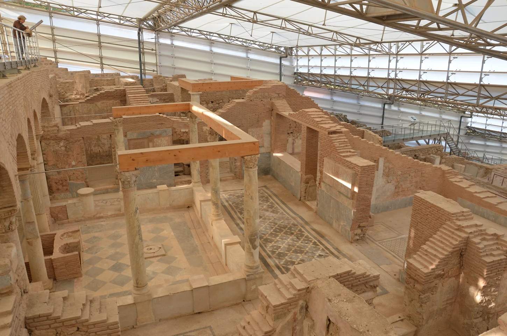

Спробуйте прочитати перші три вірші удвох. Нехай один читає вголос, а другий слухає, закривши книгу. Ще до кінця третього вірша обоє почуєте про себе. [Об. 1:1-3](bible:Rev1:1:3)

Художня ілюстрація до Об. 1:3.

| Вірш | Простежте шлях звістки |
| --- | --- |
| 1:1 | Бог дає об’явлення Ісусові Христу. Через ангела воно доходить до Івана, щоб інші теж дізналися, що має статися. |
| 1:2 | Іван розповідає, що бачив. Тепер інша людина може почути, що він засвідчив про Боже слово і свідчення Ісуса Христа. |
| 1:3 | Один читає, багато хто слухає. Коли читання закінчується, благословення залишається з тими, хто береже почуте й живе згідно з ним. |

Коли читаєте вірш уголос і доходите до слова «блаженний», то помічаєте, що читаєте про себе. А про кого далі йдеться у вірші? Поміняйтеся ролями й прочитайте його ще раз. [Об. 1:3](bible:Rev1:3)

Що означає берегти почуте сьогодні? Можливо, за читанням ви згадали людину, якій давно обіцяли зателефонувати. Почніть із цього дзвінка. А тоді запитайте одне одного, яке слово з цих трьох віршів вам хочеться взяти із собою і чому. [Як. 1:22](bible:Jas1:22) · [Ів. 14:15](bible:John14:15)

<!-- study:deeper -->

Натисніть на грецьке слово з посиланням, щоб порівняти рукописи. В основному читанні [Об. 1:3](bible:Rev1:3) одна людина читає, а багато людей слухають. Зведений текст нижче містить читання, зіставлені в застосунку. Критичне видання наводить і варіант, у якому і читачі, і слухачі згадуються у множині.¹

#### Першоджерела

- `01` [Синайський кодекс](word:U001)
- `02` [Александрійський кодекс](word:U002)
- `04` [Кодекс Єфрема](word:U004)
- `046` [Ватиканський кодекс 2066](word:U046)
- `025` [Порфиріанський кодекс](word:U025)

#### Консолідований варіантний текст

Нижче не "реконструйований остаточний текст", а саме загальний зведений текст, у який вбудовані всі реально засвідчені розбіжності.

**Об. 1:1**
[ΑⲠⲞⲔΑⲖⲨⲯⲒⲤ](words:U001:325v:2;U002:150r:0;U046;U025) [Ⲓ̅Ⲩ̅](words:U001:325v:3;U002:150r:1;U046;U025) [Ⲭ̅Ⲩ̅](words:U001:325v:4;U002:150r:2;U046;U025) [ⲎⲚ](words:U001:325v:5;U002:150r:3;U046;U025) [ⲈⲆⲰⲔⲈⲚ](words:U001:325v:6;U002:150r:4;U046;U025) **❗{ [ΑⲨⲦⲰ](words:U001:325v:7;U002:150r:5;U025) | ΑⲨⲦⲎ }** [Ⲟ](words:U001:325v:8;U046;U025) [Ⲑ̅Ⲥ̅](words:U001:325v:9;U046;U025) [ⲆⲈⲒⲜΑⲒ](words:U001:325v:10;U002:150r:6;U046;U025) [ⲦⲞⲒⲤ](words:U001:325v:11;U002:150r:7;U046;U025) **❗{ [ΑⲄⲒⲞⲒⲤ](words:U001:325v:12) | [ⲆⲞⲨⲖⲞⲒⲤ](words:U002:150r:8;U046;U025) }** [ΑⲨⲦⲞⲨ](words:U001:325v:14;U002:150r:9;U046;U025) [Α](words:U001:325v:15;U002:150r:10;U046;U025) [ⲆⲈⲒ](words:U001:325v:16;U002:150r:11;U046;U025) [ⲄⲈⲚⲈⲤⲐΑⲒ](words:U001:325v:17;U002:150r:12;U046;U025) [ⲈⲚ](words:U001:325v:18;U002:150r:13;U046;U025) [ⲦΑⲬⲈⲒ](words:U001:325v:19;U002:150r:14;U046;U025) [ⲔΑⲒ](words:U001:325v:20;U002:150r:15;U046;U025) [ⲈⲤⲎΜΑⲚⲈⲚ](words:U001:325v:21;U002:150r:16;U046;U025) [ΑⲠⲞⲤⲦⲈⲒⲖΑⲤ](words:U001:325v:22;U002:150r:17;U046;U025) [ⲆⲒΑ](words:U001:325v:23;U002:150r:18;U046;U025) [ⲦⲞⲨ](words:U001:325v:24;U002:150r:19;U046;U025) [ΑⲄⲄⲈⲖⲞⲨ](words:U001:325v:25;U002:150r:20;U046;U025) [ΑⲨⲦⲞⲨ](words:U001:325v:26;U002:150r:21;U046;U025) **❗{ [ⲦⲰ](words:U001:325v:27;U046;U025) [ⲆⲞⲨⲖⲰ](words:U001:325v:28;U046;U025) | [ⲦⲞⲨ](words:U002:150r:22) [ⲆⲞⲨⲖⲞⲨ](words:U002:150r:23) }** [ΑⲨⲦⲞⲨ](words:U001:325v:29;U002:150r:24;U046;U025) **❗{ [ΪⲰΑⲚⲈⲒ](words:U001:325v:30) | [ΪⲰΑⲚⲚⲎ](words:U002:150r:25;U046;U025) }**

**Об. 1:2**
[ⲞⲤ](words:U001:325v:31;U002:150r:26;U004:197r:0;U046;U025) **❗{ [ⲈΜΑⲢⲦⲨⲢⲎⲤⲈⲚ](words:U001:325v:32;U002:150r:27;U004:197r:1;U046) | ⲈΜΑⲢⲦⲨⲢⲒⲤⲈⲚ }** [ⲦⲞⲚ](words:U001:325v:33;U002:150r:28;U004:197r:2;U046;U025) [ⲖⲞⲄⲞⲚ](words:U001:325v:34;U002:150r:29;U004:197r:3;U046;U025) [ⲦⲞⲨ](words:U001:325v:35;U002:150r:30;U004:197r:4;U046;U025) [Ⲑ̅Ⲩ̅](words:U001:325v:36;U002:150r:31;U004:197r:5;U046;U025) [ⲔΑⲒ](words:U001:325v:37;U002:150r:32;U004:197r:6;U046;U025) [ⲦⲎⲚ](words:U001:325v:38;U002:150r:33;U004:197r:6;U046;U025) [ΜΑⲢⲦⲨⲢⲒΑⲚ](words:U001:325v:39;U002:150r:34;U004:197r:7;U046;U025) [Ⲓ̅Ⲩ̅](words:U001:325v:40;U002:150r:35;U004:197r:8;U046;U025) [Ⲭ̅Ⲩ̅](words:U001:325v:41;U002:150r:36;U004:197r:9;U046;U025) [ⲞⲤΑ](words:U001:325v:42;U002:150r:37;U004:197r:10;U046;U025) **❗{ [ΪⲆⲈ](words:U001:325v:43) | [ΪⲆⲈⲚ](words:U002:150r:38;U046) | [ⲈⲒⲆⲈⲚ](words:U004:197r:11;U025) }**

**Об. 1:3**
[ΜΑⲔΑⲢⲒⲞⲤ](words:U001:325v:44;U002:150r:39;U004:197r:12;U046;U025) [Ⲟ](words:U001:325v:45;U002:150r:40;U004:197r:13;U046;U025) [ΑⲚΑⲄⲒⲚⲰⲤⲔⲰⲚ](words:U001:325v:46;U002:150r:41;U004:197r:14;U046;U025) [ⲔΑⲒ](words:U001:325v:47;U002:150r:42;U004:197r:15;U046;U025) [ⲞⲒ](words:U001:325v:48;U002:150r:43;U004:197r:16;U046;U025) [ΑⲔⲞⲨⲞⲚⲦⲈⲤ](words:U001:325v:49;U002:150r:44;U004:197r:17;U046;U025) **❗{ [ⲦⲞⲚ](words:U001:325v:50;U046) [ⲖⲞⲄⲞⲚ](words:U001:325v:51;U046) | [ⲦⲞⲨⲤ](words:U002:150r:45;U025) [ⲖⲞⲄⲞⲨⲤ](words:U002:150r:46;U025) | [ⲦⲞⲨⲤ](words:U004:197r:18) [ⲖⲞⲄⲞⲨⲤ](words:U004:197r:19) [ⲦⲞⲨⲦⲞⲨⲤ](words:U004:197r:20) }** [ⲦⲎⲤ](words:U001:325v:52;U002:150r:47;U004:197r:21;U046;U025) **❗{ [ⲠⲢⲞⲪⲎⲦⲒΑⲤ](words:U001:325v:53;U004:197r:22) | [ⲠⲢⲞⲪⲎⲦⲈⲒΑⲤ](words:U002:150r:48;U046;U025) }** [ⲔΑⲒ](words:U001:325v:54;U002:150r:49;U004:197r:23;U046;U025) [ⲦⲎⲢⲞⲨⲚⲦⲈⲤ](words:U001:325v:55;U002:150r:50;U004:197r:24;U046;U025) [ⲦΑ](words:U001:325v:56;U002:150r:51;U004:197r:25;U046;U025) [ⲈⲚ](words:U001:325v:57;U002:150r:52;U004:197r:26;U046;U025) [ΑⲨⲦⲎ](words:U001:325v:58;U002:150r:53;U004:197r:27;U046;U025) [ⲄⲈⲄⲢΑΜΜⲈⲚΑ](words:U001:325v:59;U002:150r:54;U004:197r:28;U046;U025) [Ⲟ](words:U001:325v:60;U002:150r:55;U004:197r:29;U046;U025) [ⲄΑⲢ](words:U001:325v:61;U002:150r:56;U004:197r:30;U046;U025) [ⲔΑⲒⲢⲞⲤ](words:U001:325v:62;U002:150r:57;U004:197r:31;U046;U025) [ⲈⲄⲄⲨⲤ](words:U001:325v:63;U002:150r:58;U004:197r:32;U046;U025)

У третьому вірші рукописи дають змогу почути і «слово», і «слова». Тепер прислухайтеся до дієслів. Як звістка доходить до тих, хто її чує?

Зверніть увагу, хто діє в кожному з трьох віршів. У першому [Бог дає об’явлення](bible:Rev1:1), у другому [Іван свідчить](bible:Rev1:2), у третьому [одна людина читає, а інші слухають і бережуть почуте](bible:Rev1:3). Пам’ятаючи цю послідовність, повернімося до початку.

### Вірш 1. Звідки Іван дізнався?

«[Об’явлення Ісуса Христа](bible:Rev1:1)» - так починається книга. Перше грецьке слово, *[апокаліпсис](strong:G602)*, тут означає розкриття чогось досі прихованого. Звідки ця звістка? Бог дав її Ісусові Христу для Своїх слуг. А що ми дізнаємося про Самого Ісуса? Уже в п’ятому вірші Його названо [вірним Свідком і первістком із мертвих](bible:Rev1:5). Там само Іван говорить про Христову любов до нас. Так перші рядки допомагають почути два можливі значення назви. Хто відкриває? І хто відкривається читачеві?

Що спонукало Івана написати книгу? Один священник звертає увагу на зв’язок між дорученням, яке Іван отримав на Патмосі, і словами Христа, які згодом почує кожна церква і які звернені саме до неї.² Прислухайтеся до [доручення в одинадцятому вірші](bible:Rev1:11). Іван має записати те, що бачить, і надіслати книгу сімом церквам. Тепер ми знаємо, для кого він пише.

У словах «[що має статися](bible:Rev1:1)» відлунює знайома біблійна історія. Вавилонському цареві наснився сон. Коли він просить Даниїла пояснити його, Даниїл говорить про [Бога, Який відкриває таємниці](bible:Dan2:28). У грецькому тексті цього вірша й в [Об. 1:1](bible:Rev1:1) поруч стоять ті самі три слова [ἃ](strong:G3739) [δεῖ](strong:G1163) [γενέσθαι](strong:G1096) («що має статися»).³ У книзі Даниїла [об’явлення отримує цар](bible:Dan2:45), а тут звістку адресовано Божим слугам. Іван додає «[незабаром](words:U001:325v:19;U002:150r:14)». Схожість і слів, і самої ситуації дає підстави почути тут відгомін Даниїла.

### Вірш 2. Що може стверджувати свідок?

Іван сам визначає межі своїх слів. [Він засвідчив те, що бачив](bible:Rev1:2). Грецькі слова «[засвідчив](strong:G3140)» і «[свідчення](strong:G3141)» споріднені й стоять в одному короткому реченні. Прислухайтеся до цього перегуку. Історія починається з Бога, та до слухача вона доходить через голос людини, яка відповідає за свою розповідь про побачене. Трохи далі [вірним Свідком](bible:Rev1:5) названо Самого Ісуса. Під час читання спершу з’ясуйте, що саме Іван побачив. Потім подумайте, що це може означати. Які слова в уривку підказують вам таке пояснення?

Трохи далі Іван згадає [острів Патмос](bible:Rev1:9) і знову вживе поруч вислови [«слово Боже» і «свідчення Ісуса»](bible:Rev1:2). На початку ми дізнаємося, про що він свідчив. Тепер ті самі вислови з’являються в розповіді про його власне життя. Прочитайте обидва уривки вголос. Що змінюється, коли за голосом відкриваєш долю людини?

Що ж побачив Іван і що йому доручили записати? У [першому видінні](bible:Rev1:17:19) Іван падає до ніг Того, хто до нього промовляє. Він каже Іванові, що був мертвий, а тепер живе повіки, і велить записати побачене. Коли Іван називає Ісуса вірним Свідком, він може розповісти своїм слухачам і про те, що сказав йому сам воскреслий Христос.

### Вірш 3. Що чути в кімнаті, де читають?

Зверніть увагу, де в грецькому тексті вжито однину, а де множину. «[Той, хто читає](words:U001:325v:46;U002:150r:41;U004:197r:14)», - одна людина. «[Ті, хто слухає](words:U001:325v:49;U002:150r:44;U004:197r:17)», і «[ті, хто береже](words:U001:325v:55;U002:150r:50;U004:197r:24)», - багато людей. Легко уявити громаду, де одна людина вимовляє слова вголос, а інші чують їх і беруть із собою. Уже в наступному вірші названо перших адресатів - [сім церков в Азії](bible:Rev1:4).

Ефес стоїть першим у переліку [семи церков](bible:Rev1:11), і саме до ефеської громади звернене [перше послання](bible:Rev2:1). Де в такому місті могли збиратися християни? Павло пише коринтянам, що [ще побуде в Ефесі](bible:1Cor16:8), і передає їм вітання від Акили, Приски та [громади, яка збирається в їхньому домі](bible:1Cor16:19). На фотографії можна роздивитися житлову архітектуру римського Ефеса. Два будинки в цьому комплексі археологи датують початком I століття. Кімнати в них розташовувалися навколо внутрішніх дворів із колонами.⁴

*Внутрішній двір із колонами в комплексі римських житлових будинків на терасах, Ефес, Туреччина. Фото shankar s., 2014, CC BY 2.0. Зображення зменшено й перетворено на WebP.⁴*

На початку II століття Пліній, римський намісник Віфінії та Понту на півночі сучасної Туреччини, писав імператорові Траяну про допити місцевих жителів. Люди, яких він розпитував, розповіли, що християни у визначений день збиралися до світанку й співали гімн Христові. Тих, хто й далі називав себе християнином, могли покарати.⁵ Пригадайте, як Іван називає себе [братом, який поділяє з ними скорботу й терпіння](bible:Rev1:9). Як звучать ці слова для людей, яким доводиться відповідати за свою віру?

У III столітті один єпископ звернув особливу увагу на слова «[ті, хто береже](strong:G5083)». На його думку, людина докладає зусиль до читання, щоб навчитися діяти згідно з прочитаним.⁶ Спробуйте прочитати [вірш](bible:Rev1:3), на мить оминувши слова про те, що написане слід берегти. А тепер прочитайте його повністю. Що змінюється для слухача?

| Рукопис і сторінка в застосунку Revelation | Як звучить вислів у перекладі |
| --- | --- |
| Синайський кодекс, 325v: τὸν [λόγον](word:U001:325v:51) | «слово» пророцтва |
| Александрійський кодекс, 150r: τοὺς [λόγους](word:U002:150r:46) | «слова» пророцтва |
| Кодекс Єфрема, 197r: τοὺς [λόγους](word:U004:197r:19) τούτους | «ці слова» пророцтва |

Порівняйте в таблиці, що чують люди: [«слово», «слова» чи «ці слова»](words:U001:325v:51;U002:150r:46;U004:197r:19). А що вони роблять із почутим? Відкрийте вислів «[ті, хто береже](words:U001:325v:55;U002:150r:50;U004:197r:24)» і подивіться, як його записано в усіх трьох рукописах. У словнику порівняйте артикль [τὸν / τοὺς](strong:G3588), форми іменника [λόγον / λόγους](strong:G3056) і вказівний займенник [τούτους](strong:G3778) («ці»).

Задовго до Івана Мойсей звелів [прочитати закон уголос](bible:Deut31:11) і [зібрати народ, щоб люди почули його й навчилися виконувати](bible:Deut31:12). Тут бачимо подібний образ вірності завітові. Даниїлові велено [запечатати книгу до часу кінця](bible:Dan12:4). Наприкінці Об’явлення Іванові велено [залишити слова пророцтва незапечатаними](bible:Rev22:10). Порівняйте обидва веління. Яке з них допомагає зрозуміти, чому зібрана громада в Івана вже може почути благословення?

Прислухайтеся до схожого благословення в [Євангелії від Луки 11:27-28](bible:Luke11:27:28). Жінка з натовпу називає Ісусову матір блаженною. Ісус відповідає, що блаженні ті, хто слухає Боже слово й виконує його. Згадайте тепер слухачів, про яких ідеться в [Об’явленні 1:3](bible:Rev1:3). Що вони можуть зробити, коли читання закінчиться?

### Чому «час близько»?

Іван уживає два різні вислови. У [першому вірші](bible:Rev1:1) слово «незабаром» стосується того, що має статися. У [третьому](bible:Rev1:3) Іван каже, що сам час уже близький. Прочитайте вислів «час бо близький» і зверніть увагу на слово «бо». Як воно допомагає зрозуміти, чому слухачам важливо вже тепер виконувати почуте?

Зазирніть в останні рядки книги. Знову з’являються [ангел, слуги і звістка про те, що має незабаром статися](bible:Rev22:6). У наступному вірші поруч із [Христовою обіцянкою прийти незабаром](bible:Rev22:7) звучить благословення тому, хто береже слова пророцтва. Перед очима читача вже пройшли видіння. Як він відгукнеться? До якої дії Іван заохочує людей, що чують про близькість часу? У вступних віршах немає дати. У Євангелії Ісус каже учням, що [вони не знають ані дня, ані години](bible:Mat24:36).

У [третьому вірші](bible:Rev1:3) ми чуємо перше із семи блаженств Об’явлення.⁷ Знайдіть ще одне у [19:9](bible:Rev19:9). Там блаженними названо [гостей, запрошених на весільну вечерю Агнця](bible:Rev19:9). У [22:7](bible:Rev22:7) благословення знову звернене [до того, хто береже слова книги](bible:Rev22:7). Кого ви уявляєте, коли чуєте кожну із цих обітниць?

У XVI столітті один проповідник уявляв слухача, який думає, що описані події стосуються лише людей далекого майбутнього. Такому слухачеві він нагадував останні слова вірша «[час близько](bible:Rev1:3)».⁸ Що зміниться, якщо побачити й себе серед тих, до кого сьогодні звертається книга?

Прочитайте [перші три вірші](bible:Rev1:1:3) ще раз і закінчіть фразу «Сьогодні я почув…» своїми словами. Запитайте одне одного, [у якому вчинку могло б виявитися почуте](bible:Jas1:22). Коли побачитеся наступного разу, почніть із розповіді про те, що сталося після читання.

**[Спробуйте пошук паралелей](screen:allusion_search).** Виберіть [Об. 1:1](bible:Rev1:1), довжину в один вірш, Старий Завіт і результати за віршами. У цьому індексі першим з’являється [Бут. 24:7](bible:Gen24:7). В обох уривках Бог посилає [ангела](words:U001:325v:25;U002:150r:20). Та в розповіді про Авраама ангел іде попереду слуги, який вирушив шукати дружину для Ісаака. Порівняйте цю історію з [Дан. 2:28](bible:Dan2:28). Яка з них краще допомагає зрозуміти *відкриття того, що має статися*? У цьому прикладі пошук знаходить спільний образ, а читання обох історій допомагає зважити його значення.

<!-- study:references -->

---

1. [Institut für Neutestamentliche Textforschung. Novum Testamentum Graecum, Editio Critica Maior, VI/1, Об’явлення 1:3, позиції 4-12](https://shop.die-bibel.de/media/bc/2c/b7/1733099623/ECM%20VI1.%20Offenbarung.%20Text.pdf.pdf#page=34)
2. [Thomas Hopko. The Orthodox Faith, т. I, «Book of Revelation», абзац про доручення написати сімом церквам](https://www.oca.org/orthodoxy/the-orthodox-faith/doctrine-scripture/new-testament/book-of-revelation#:~:text=Saint%20John%20received%20his%20vision)
3. [R. Timothy McLay. A New English Translation of the Septuagint, «Daniel», дві давньогрецькі редакції Дан. 2:28, с. 997](https://ccat.sas.upenn.edu/nets/edition/40-daniel-nets.pdf#page=7)
4. [Інгрід Аденштедт. Terrace House 2 in Ephesus. Dwelling Units 3 and 5, опис проєкту Австрійського наукового фонду](https://www.fwf.ac.at/en/research-radar/10.55776/PUB1315). [shankar s., оригінал фотографії (2014)](https://commons.wikimedia.org/wiki/File:Overview_of_the_Terrace_houses_%2816314206402%29.jpg), [ліцензія CC BY 2.0](https://creativecommons.org/licenses/by/2.0/).
5. [Пліній Молодший. Листи, 10.96, §§ 3, 7, англійський переклад Дж. Б. Ферта](https://www.attalus.org/pliny/ep10b.html#96). [Відповідь Траяна, 10.97, § 2](https://www.attalus.org/pliny/ep10b.html#97).
6. [Вікторин Петавійський. Commentary on the Apocalypse of the Blessed John, розд. I, § 1, англійський переклад](https://www.newadvent.org/fathers/0712.htm#:~:text=The%20beginning%20of%20the%20book%20promises%20blessing)
7. [New American Bible, Revised Edition. Примітка до Об. 1:3 про сім блаженств](https://bible.usccb.org/bible/revelation/1#74001003-1)
8. [Генріх Буллінгер. A Hundred Sermons upon the Apocalips of Iesu Christe, друга проповідь, англійське видання 1561 року, с. 17-18](https://earlyenglishprintedsermons.org/segment/B11837/298)
